# CareNest — Enterprise Hospital Management System (HMS)

[](https://developer.salesforce.com/)
[](https://developer.salesforce.com/)
[](https://www.salesforce.com/agentforce/)
[](docs/architecture.md)
[-10B981)](#testing--verification)
[](LICENSE)

**CareNest** is a full-featured, enterprise-grade Hospital Management System built natively on the **Salesforce Lightning Platform**. It unifies outpatient scheduling, inpatient bed allocation, bedside clinical telemetry, billing workflows, executive revenue analytics, and autonomous **Agentforce AI** agents into a centralized hospital command center.

---

## 🏛️ System Architecture

CareNest implements the **Separation of Concerns (SoC)** architectural pattern, cleanly isolating Presentation (LWC), Orchestration (Apex Controllers), Domain Services, Background Batches, and Database Security.

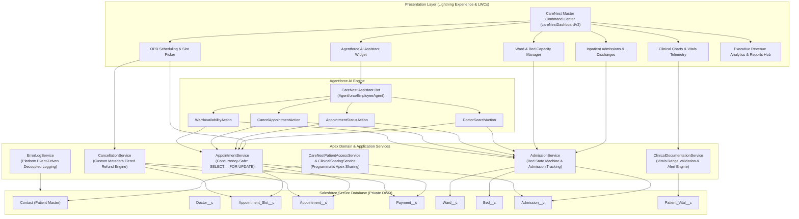

---

## 🏥 12 Integrated Operational Modules

CareNest provides a single, unified workspace for hospital leadership, clinicians, nurses, and administrative personnel:

| # | Module Name | Primary Responsibilities |
|---|---|---|
| **1** | **Hospital Command Center** | Real-time hospital telemetry, total bed occupancy (47.6% across 42 physical beds), inpatient census (20 active admissions, 19 available beds), and live emergency hotline integration. |
| **2** | **Executive Revenue Analytics** | 7 financial metrics and visualizations: Recorded Successful Collections, Collections Less Refund Obligations, Refund Entitlements, Post-Service Open Balances, Accrued Inpatient Bed Charges, Department Revenue Distribution progress chart, and Post-Service Receivables Aging 4-bucket breakdown. |
| **3** | **Patient Registry Workspace** | Intake management, demographic lookup, duplicate prevention, and medical history navigation. |
| **4** | **Doctors & Staff Directory** | Physician rosters, clinical departments (General Medicine, Cardiology, Paediatrics, Orthopaedics, ENT, Dermatology), and fee schedules. |
| **5** | **Outpatient Appointments (OPD)** | 4-step guided booking wizard (`appointmentWizard`) with reactive date-filtered slot selection (`slotPicker`). |
| **6** | **Inpatient Admissions (IPD)** | Bed reservation, attending doctor assignment, clinical diagnosis capture, and length-of-stay tracking. |
| **7** | **Ward & Bed Capacity Manager** | Interactive floor plan managing ward capacities, bed statuses (`Available`, `Occupied`, `Maintenance`, `Cleaning`), and census rollups. |
| **8** | **Clinical Charts & Vitals** | Bedside vital signs entry, physiological range checks, abnormal alert flagging, and physician consultation documentation (`Inpatient_Encounter__c`). |
| **9** | **Reports & Analytics Hub** | Centralized access to **16 certified CareNest Salesforce Reports** across Financial Analytics, Hospital Operations, Clinical & Physician, and Additional Operations. |
| **10** | **Cashier Desk & Patient Billing** | POS desk modal supporting simulated Cash, Card, and UPI settlements, invoice receipt rendering, and balance reconciliation. |
| **11** | **Agentforce AI Assistant** | Autonomous AI copilot (`agentforceAssistantWidget`) executing governed Invocable Actions with hardcoded clinical emergency safety guardrails. |
| **12** | **System Health & RBAC Audit** | Administrative audit logs, platform event error feeds, and Zero-Trust Role-Based Access Control monitoring. |

---

## 💻 Technology Stack

- **Platform:** Salesforce Lightning Experience (API v61.0 / v68.0)
- **Backend Languages:** Apex (Domain Services, Triggers, Batch Apex, Queueable Apex, Schedulable Apex)
- **Frontend Framework:** Lightning Web Components (LWC), Shadow DOM, Lightning Message Service (LMS), SVG Data Visualizations
- **AI & Automation:** Salesforce Agentforce (`AgentforceEmployeeAgent`), Invocable Apex Actions, Record-Triggered Flows, Scheduled Flows, Screen Flows
- **Configuration & Rules:** Custom Metadata Types (`Cancellation_Policy__mdt`), 30 Declarative Validation Rules, Custom Permissions
- **Security & Data:** Organization-Wide Defaults (OWD), Programmatic Apex Sharing, 9 Permission Sets, Platform Events (`Error_Log_Event__e`)
- **Testing & Tooling:** Salesforce CLI (`sf`), Node.js Static AST Test Suites (205 tests), Playwright MCP for Cross-Viewport Verification

---

## 🔒 Security Architecture & Zero-Trust RBAC

CareNest strictly enforces the principle of least privilege:
- **Baseline Privacy:** Core healthcare objects (`Contact`, `Admission__c`, `Inpatient_Encounter__c`, `Patient_Vital__c`, `Payment__c`, `Appointment__c`) are configured with **Private** Organization-Wide Defaults.
- **Programmatic Apex Sharing:** Attending doctors and ward nurses are dynamically granted row-level access upon patient admission (`CareNestPatientAccessService` & `ClinicalSharingService`), automatically revoked upon discharge.
- **Server-Side Financial Security:** Non-admin users are strictly filtered on the server side in `CareNestDashboardController`. Sensitive revenue metrics and financial report links are excluded from Lightning payloads for non-administrative roles.
- **Data Isolation:** Cleanly isolated from legacy or external project data (e.g. MiniCare) with zero references to foreign report IDs or shared patient IDs.

---

## 📸 Authentic Application Screenshots

All screenshots are captured directly from live Salesforce execution (`/lightning/app/c__CareNest`):

| View | Screenshot Preview | Detailed Description |
|---|---|---|
| **Hospital Command Center** | [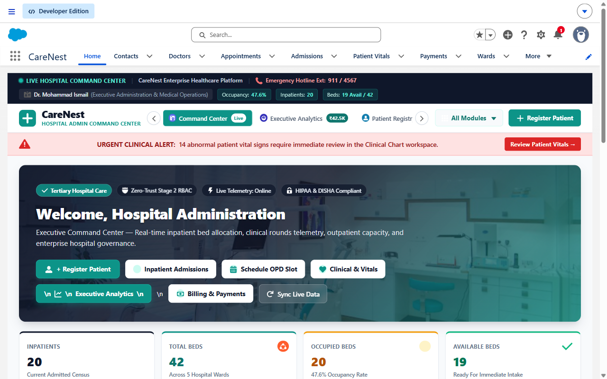](docs/screenshots/01_unified_home.png) | High-level hospital operational telemetry, dynamic navigation badges, live bed count, and active alerts. |
| **Executive Admin & Analytics** | [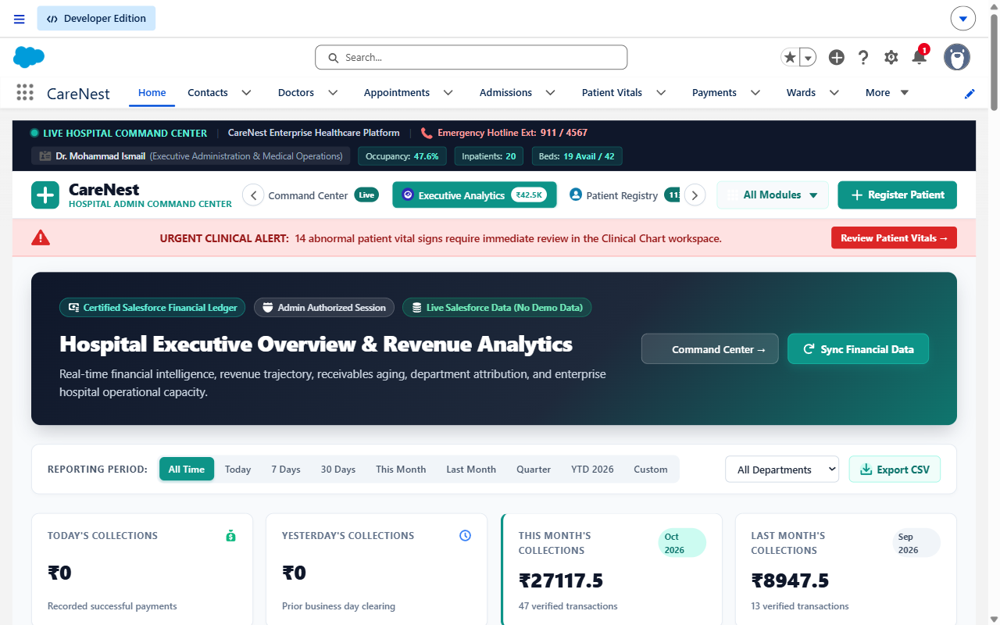](docs/screenshots/02_admin_overview.png) | High-precision accounting KPIs, collections trends, post-service aging, and 16 Salesforce reports catalog. |
| **Patient Registration** | [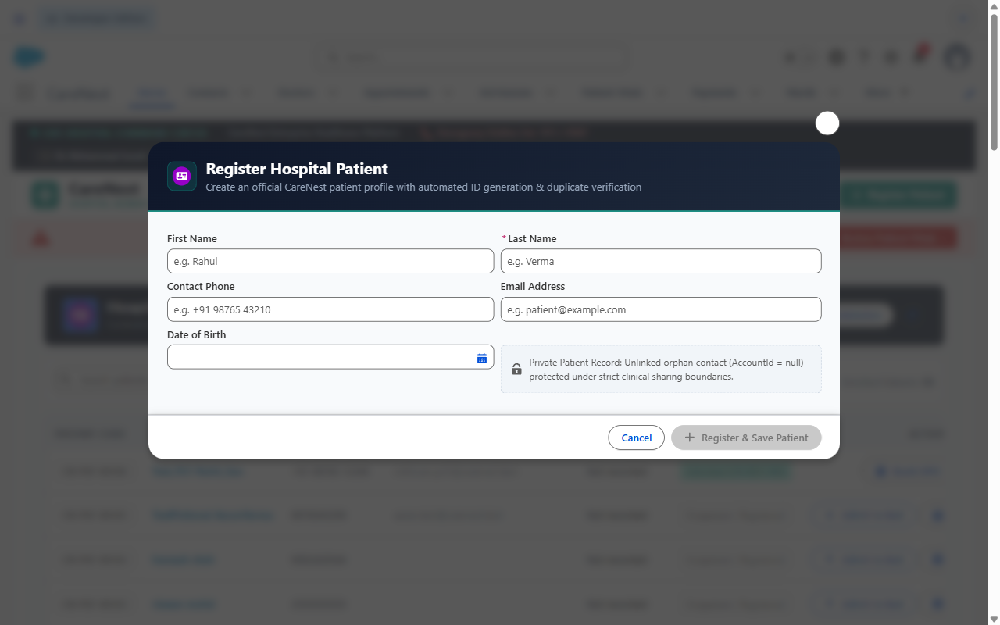](docs/screenshots/04_patient_registration.png) | Intake modal supporting demographic entry, contact details, and server-side duplicate prevention. |
| **Patient Registry Directory** | [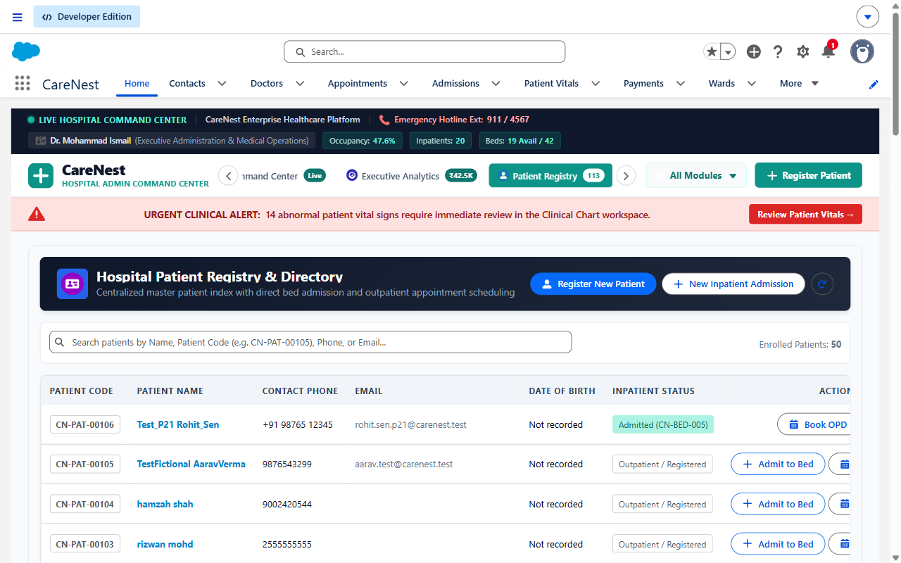](docs/screenshots/15_patient_registry_table.png) | Master patient registry table with instant search, patient code lookup, and direct "Admit to Bed" actions. |
| **Doctors & Staff Directory** | [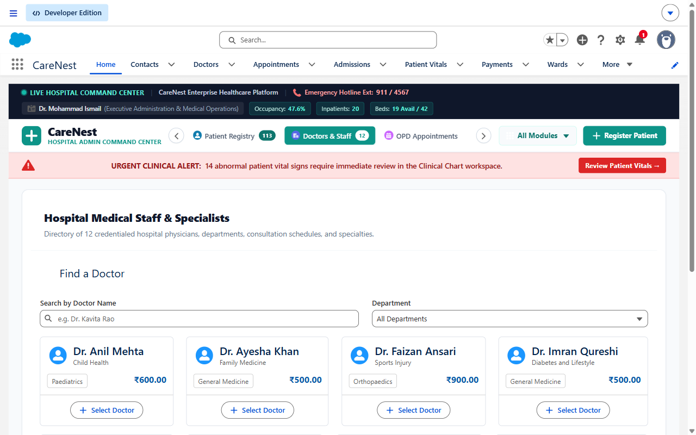](docs/screenshots/06_doctor_staff_directory.png) | Physician rosters across 6 specialties, consultation fee schedules, and shift availability indicators. |
| **Ward & Bed Manager** | [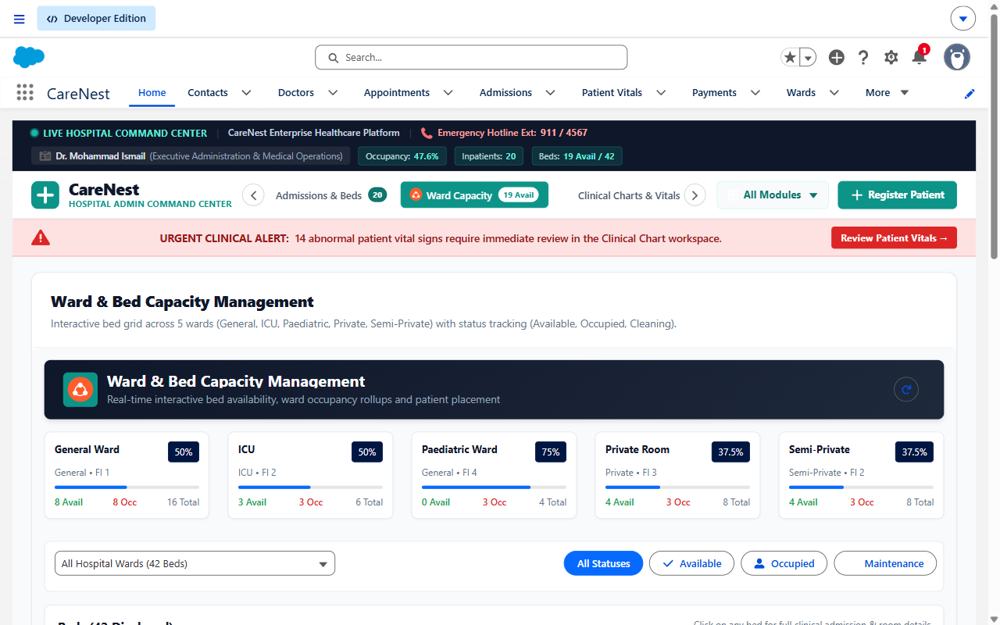](docs/screenshots/07_ward_bed_management.png) | Floor-plan ward capacity matrix managing 42 physical beds across Available, Occupied, Cleaning, and Maintenance states. |
| **Admission Wizard & Validation** | [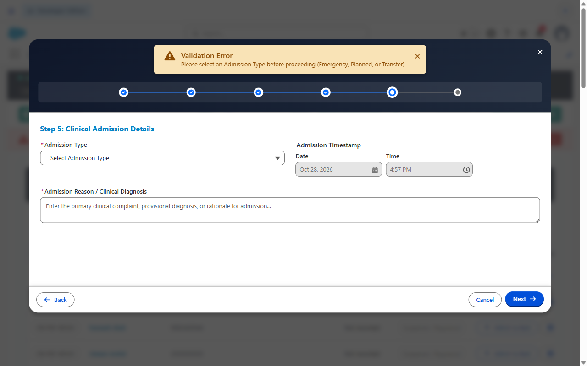](docs/screenshots/16_admission_wizard_validation.png) | 6-step inpatient intake wizard enforcing mandatory Admission Type selection guard (Emergency, Planned, Transfer). |
| **Inpatient Admissions Census** | [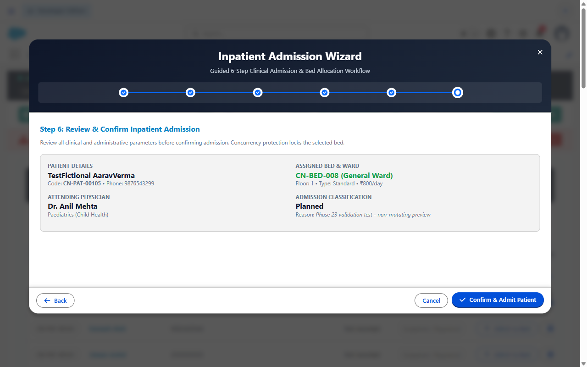](docs/screenshots/08_inpatient_admissions.png) | Inpatient census table, attending physician assignment, length-of-stay tracking, and discharge summary desk. |
| **Clinical Charts & Vitals** | [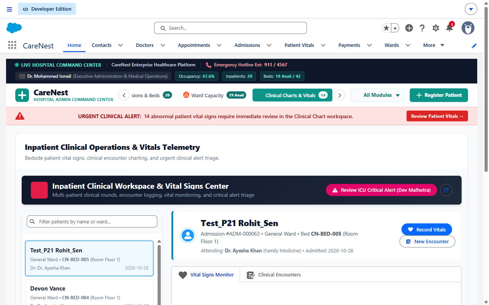](docs/screenshots/09_clinical_charts_alerts.png) | Bedside vitals telemetry, physiological range validation, and physician consultation documentation. |
| **Cashier Desk & Billing** | [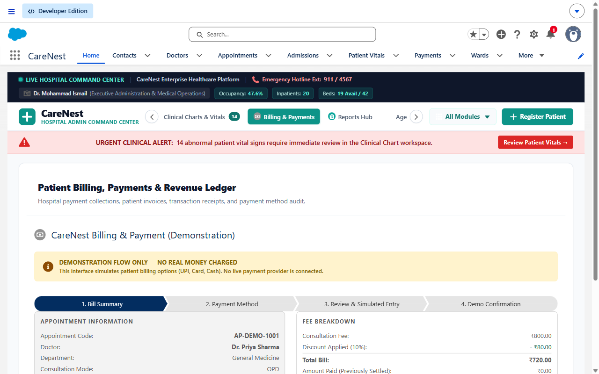](docs/screenshots/10_billing_and_payments.png) | Outpatient payment settlement modal (simulated Cash, Card, UPI) and itemized receipt generation. |
| **Agentforce AI Assistant** | [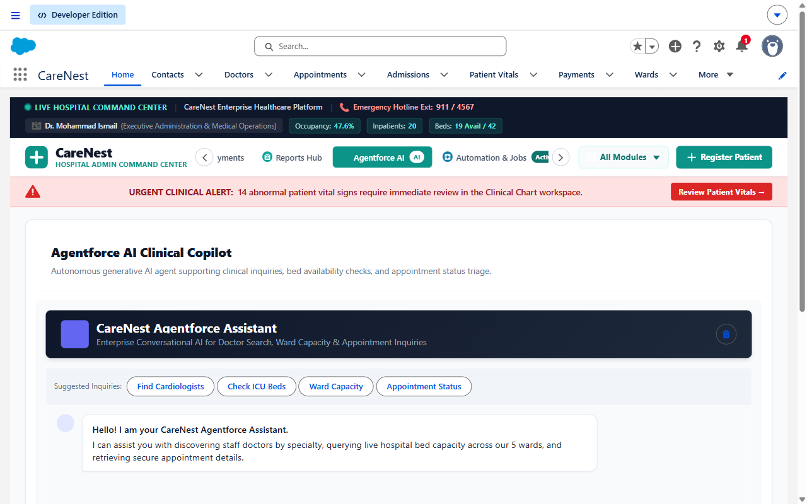](docs/screenshots/13_agentforce_assistant.png) | Autonomous copilot interface executing governed Invocable Actions with hardcoded clinical emergency safety guardrails. |
| **Mobile Responsive Layout** | [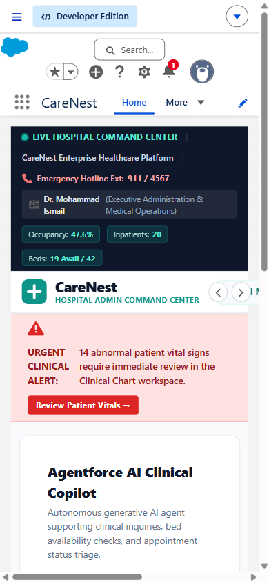](docs/screenshots/14_mobile_responsive_view.png) | Fully responsive mobile navigation drawer and single-column cards (390x844 viewport). |

---

## 🧪 Testing & Verification

CareNest maintains 100% pass rates across local static analysis suites, full org-wide Apex regression test suites (88% code coverage across 337 tests), and end-to-end browser verification:

```
=================================================================
 APEX REGRESSION & ADMISSION TEST VERIFICATION (100% PASS RATE)
=================================================================
 Org-Wide Apex Code Coverage: 88.0% (Passing 337 / 337 tests org-wide)
 Target Org ID              : 00Dg700000Cpr9pEAB (carenest)
 Phase 21/22 Deployment Job : 0Afg700000HCFBECA5 (34 / 34 targeted tests PASSED)

 Key Test Suites:
  - CareNestAdmissionControllerTest : 21 / 21 PASSED (100% class coverage)
  - CareNestPatientSharingTest      : 13 / 13 PASSED (100% class coverage)
  - CareNestDashboardControllerTest :  8 /  8 PASSED (100% class coverage)

=================================================================
 LOCAL AUTOMATED TEST SUITES (205 / 205 CHECKS PASSED - 100%)
=================================================================
 scripts/test_admin_analytics_local.js    : 153 / 153 PASSED (0 failures)
 scripts/test_careNestDashboardV2_local.js:  52 /  52 PASSED (0 failures)
```

- **Phase 21/22 Verified Deployment Job ID:** `0Afg700000HCFBECA5` (Status: `Succeeded`, 34/34 Apex Tests Passed)
- **Live End-to-End Verification:** Contact `Test_P21 Rohit_Sen` (`CN-PAT-00106`) registered, Admitted (`ADM-000063`) to Bed `GW-05` (`CN-BED-005`), Occupancy successfully updated from 19 to 20 inpatients in live org.

---

## 🚀 Setup & SFDX Deployment Instructions

### Prerequisites
- [Salesforce CLI (`sf`)](https://developer.salesforce.com/tools/salesforcecli) (v2.x or higher)
- A Salesforce Developer Edition, Scratch Org, or Sandbox

### 1. Authenticate Target Org
```powershell
sf org login web --alias carenest-dev --set-default
```

### 2. Deploy Metadata
Deploy the core metadata bundle using the tested manifest:
```powershell
sf project deploy start --manifest manifest/phase36-reports-hub-integration-package.xml --target-org carenest-dev --test-level RunSpecifiedTests --tests CareNestDashboardControllerTest --wait 60
```

### 3. Assign Permissions
Assign the Administrator permission set to your user:
```powershell
sf org assign permset --name CareNest_Admin --target-org carenest-dev
```

### 4. Open Application
```powershell
sf org open --path "/lightning/app/c__CareNest" --target-org carenest-dev
```

---

## 📚 Technical Documentation Suite

The complete engineering and operational documentation is maintained in the [`docs/`](docs/) directory:

| Document | Description |
|---|---|
| [**Architecture & Design**](docs/architecture.md) | Enterprise Separation of Concerns (SoC), concurrency control, state machine, and Mermaid ERD. |
| [**Features & Modules**](docs/FEATURES.md) | 15 core functional pillars mapping all 12 operational hospital modules. |
| [**Security & Governance**](docs/SECURITY.md) | Zero-Trust Stage 2 RBAC, Private OWD matrix, orphan patient isolation, and Apex managed sharing. |
| [**Testing & QA**](docs/TESTING.md) | 337/337 passing regression suite, 88% org code coverage, Phase 21/22 tests, and UI testing matrices. |
| [**Deployment & Setup**](docs/DEPLOYMENT.md) | SFDX deployment manifests, test requirements, permission set assignments, and verification runbooks. |
| [**Demo & Recruiter Walkthrough**](docs/DEMO_GUIDE.md) | 5-minute recruiter presentation script, end-to-end patient journey walkthrough, and interview QA. |
| [**Known Limitations & Boundaries**](docs/KNOWN_LIMITATIONS.md) | Architectural constraints, POS simulation boundaries, RFC 2606 data synthesis, and roadmap. |

### Additional Specialized Guides
- [Data Model & ERD](docs/data-model.md)
- [Apex Development & Concurrency Control](docs/apex-development.md)
- [Lightning Web Components (LWC) Architecture](docs/lwc-components.md)
- [Automation, Flows & Event-Driven Engine](docs/automation.md)
- [Agentforce AI Integration & Autonomous Actions](docs/agentforce.md)
- [Reports, Analytics & Financial Reconciliation](docs/reports-and-analytics.md)
- [Recruiter Portfolio Case Study](docs/recruiter-case-study.md)
- [Resume Bullets & Interview Guide](docs/resume-and-interview-guide.md)

---

## ⚖️ Portfolio Disclaimer
CareNest is developed as an educational reference architecture demonstrating advanced Salesforce platform engineering, data governance, and Agentforce capabilities. It utilizes synthetic demonstration records and mock payment desk flows. It is not certified for clinical diagnostic production deployment.
