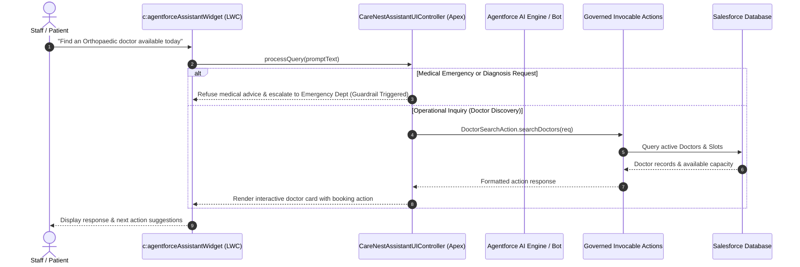

# CareNest — Agentforce AI Integration & Autonomous Actions

## 1. Overview of Agentforce in CareNest

CareNest integrates native Salesforce Agentforce AI agents (`AgentforceEmployeeAgent` / `InternalCopilot`) to deliver enterprise conversational AI for clinic staff and patients.

Unlike superficial chat widgets that rely on static text prompts, CareNest's Agentforce architecture connects autonomous reasoning directly to governed Salesforce Invocable Apex actions while enforcing strict medical safety guardrails.



---

## 2. Agentforce Bot Metadata Configuration

The primary conversational bot is defined in `force-app/main/default/bots/CareNest_Assistant/`:

- **Bot Definition (`CareNest_Assistant.bot-meta.xml`):**
  - **Type:** `AgentforceEmployeeAgent` (InternalCopilot).
  - **Template:** `EmployeeCopilot__AgentforceEmployeeAgent`.
  - **Rich Content:** Enabled (supports card carousels, action buttons, and links).
  - **Privacy:** `logPrivateConversationData = false` (protects patient privacy in compliance with healthcare data regulations).

- **Bot Version (`v1.botVersion-meta.xml`):**
  - Defines 5 core conversational topics and dialog states:
    1. **`Welcome`:** Greets user and outlines capabilities (Doctor discovery, appointment status, ward bed capacity).
    2. **`Doctor_Discovery`:** Directs inquiries to `DoctorSearchAction`.
    3. **`Appointment_Assistance`:** Directs code lookups to `AppointmentStatusAction`.
    4. **`Ward_Availability`:** Directs capacity queries to `WardAvailabilityAction`.
    5. **`Hospital_Information_and_Safe_Escalation`:** Safety triage dialog for emergency inquiries.

---

## 3. Governed Invocable Apex Actions

Agentforce autonomous agents execute transactions through four hardened `@InvocableMethod` Apex classes:

### 3.1 `DoctorSearchAction.cls`
- **Method:** `@InvocableMethod(label='Search CareNest Doctors')`
- **Inputs:** `department` (e.g. "Cardiology", "Paediatrics"), `specialtyKeyword`, `maxResults`.
- **Outputs:** List of matching doctors, departments, consultation fees, and active slot counts.
- **Safety Boundary:** Filters exclusively on `Is_Active__c = true` and sanitizes search strings to prevent SOQL injection.

### 3.2 `AppointmentStatusAction.cls`
- **Method:** `@InvocableMethod(label='Check CareNest Appointment Status')`
- **Inputs:** `appointmentIdentifier` (e.g. "APT-0012" or Record ID).
- **Outputs:** Appointment status (`Scheduled`, `Completed`, `Cancelled`), patient code, slot start time, attending doctor name, and balance due.
- **Authorization Boundary:** Validates that the requesting caller is either the patient or an authorized clinic coordinator, preventing unauthorized record exposure.

### 3.3 `CancelAppointmentAction.cls`
- **Method:** `@InvocableMethod(label='Cancel CareNest Appointment')`
- **Inputs:** `appointmentId`, `cancellationReason`.
- **Outputs:** Cancellation confirmation, notice hours calculated, refund entitlement, and retained fee.
- **Business Rule:** Directly invokes `CancellationService.cls` to ensure Custom Metadata refund tiers are enforced.

### 3.4 `WardAvailabilityAction.cls`
- **Method:** `@InvocableMethod(label='Check CareNest Ward and Bed Availability')`
- **Inputs:** `wardType` (e.g. "ICU", "General", "All").
- **Outputs:** Total beds, currently occupied beds, available beds, and operational occupancy rate percentage.

---

## 4. Clinical Safety Guardrails & Ethical AI Defenses

In healthcare applications, AI agents must **never** diagnose conditions, prescribe medications, or delay emergency medical care.

CareNest enforces hardcoded safety filters in `CareNestAssistantUIController.cls` before AI reasoning executes:

```apex
// 1. Clinical Emergency / Medical Advice Safety Guardrail
String lower = promptText.toLowerCase().trim();
if (lower.contains('chest pain') || lower.contains('trouble breathing') || 
    lower.contains('prescribe') || lower.contains('treatment') || 
    lower.contains('diagnosis') || lower.contains('emergency') || 
    lower.contains('heart attack') || lower.contains('stroke')) {
    
    dto.topic = 'Hospital_Information_and_Safe_Escalation';
    dto.actionInvoked = 'Clinical Safety Guardrail (Refusal & Escalation)';
    dto.isEmergency = true;
    dto.message = 'CareNest Assistant does not provide clinical diagnosis or treatment prescriptions. ' +
                  'For symptoms such as acute chest pain, trouble breathing, or clinical emergencies, ' +
                  'immediately alert the attending on-duty medical team, call emergency services, ' +
                  'or report to the Emergency Department.';
    return dto;
}
```

### Key Guardrail Properties:
- **Zero Medical Liability:** Instantly rejects diagnostic or prescription requests.
- **Autonomous Emergency Escalation:** Flags `isEmergency = true`, rendering high-visibility red emergency banners in the UI with direct hospital emergency extension hotline numbers (`911 / 4567`).

---

## 5. User Interface Integration (`c:agentforceAssistantWidget`)

Module 8 of the CareNest command center embeds the AI copilot directly into the hospital workflow:
- **Suggested Topic Pills:** Quick-action buttons for "Find Doctor", "Check Bed Capacity", "My Appointment Status", "Hospital Visiting Hours".
- **Real-Time Interactive Cards:** Renders responsive cards for discovered doctors or ward vacancies with single-click actions to book or admit.
- **Execution Audit Trail:** Displays the exact underlying Invocable Action invoked, response timestamp, and execution latency.
