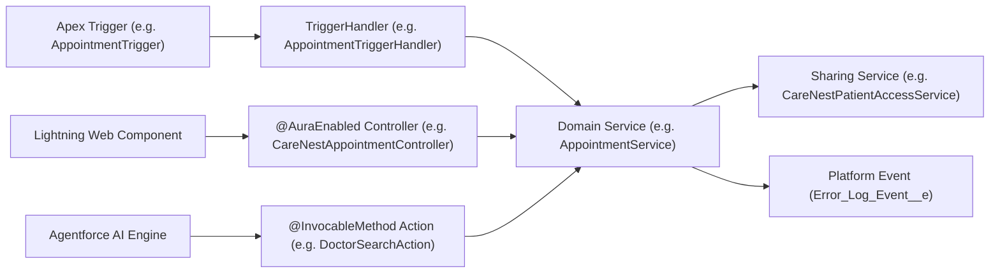

# CareNest — Apex Development, Architecture & Design Patterns

## 1. Overview of Apex Architecture

CareNest implements the Separation of Concerns (SoC) architecture recommended for enterprise Salesforce applications. The Apex codebase comprises 51 classes and 7 triggers, structured across 5 distinct architectural tiers:

1. **Trigger Framework Layer:** Thin triggers delegating to dedicated handler classes inheriting from a shared `TriggerHandler` base class.
2. **Domain Service Layer:** Pure business logic encapsulation (`AppointmentService`, `CancellationService`, `AdmissionService`, `ClinicalDocumentationService`).
3. **Application & Sharing Services:** Programmatic security and row-level sharing recalculation (`CareNestPatientAccessService`, `ClinicalSharingService`).
4. **Asynchronous Batch & Queueable Layer:** Background batch jobs and queueable SMS workers (`NoShowBatch`, `PendingExpiryBatch`, `CrossCoverReconciliationBatch`, `ReminderSmsJob`).
5. **AuraEnabled Controller Layer:** Interface controllers exposing `@AuraEnabled` methods for reactive Lightning Web Components, enforcing strict CRUD/FLS and server-side RBAC.



---

## 2. Concurrency Safety & Slot Allocation (`SELECT ... FOR UPDATE`)

In high-volume hospital environments, simultaneous appointment booking attempts on the same doctor's schedule can cause race conditions resulting in double bookings.

CareNest resolves this in `AppointmentService.cls` by executing explicit pessimistic row-level database locking:

```apex
// Pessimistic database lock on the selected slot record
List<Appointment_Slot__c> slots = [
    SELECT Id, Capacity__c, Booked_Count__c, Status__c, Slot_Start__c, Doctor__c
    FROM Appointment_Slot__c
    WHERE Id = :slotId
    FOR UPDATE
];

if (slots.isEmpty()) {
    throw new AppointmentException('Selected appointment slot was not found.');
}

Appointment_Slot__c slot = slots[0];

// Validate capacity under pessimistic lock
if (slot.Booked_Count__c >= slot.Capacity__c || slot.Status__c == 'Full') {
    throw new AppointmentException('Slot capacity has been reached. Please choose another slot.');
}

// Atomically increment booked count and create appointment
slot.Booked_Count__c = slot.Booked_Count__c + 1;
if (slot.Booked_Count__c >= slot.Capacity__c) {
    slot.Status__c = 'Full';
}
update slot;
```

By querying with `FOR UPDATE`, Salesforce places an exclusive lock on the `Appointment_Slot__c` row. Parallel transactions attempting to read that row must wait until the active transaction commits or rolls back, completely preventing overbooking.

---

## 3. Tiered Cancellation Policy Engine

Cancellations and refunds are processed through `CancellationService.cls`, driven dynamically by `Cancellation_Policy__mdt` custom metadata.

### Calculation Logic
1. Computes the notice period in hours: `hoursBefore = (slotStart - System.now()) / (1000 * 3600)`.
2. Queries the policy tier matching the notice window:
   - **Tier 1 (>24 hours):** 100% refund, 0% cancellation fee.
   - **Tier 2 (4 to 24 hours):** 75% refund, 25% cancellation fee.
   - **Tier 3 (<4 hours):** 0% refund, 100% cancellation fee.
3. Automatically creates a `Cancellation__c` audit record linking to the appointment.
4. Decrements `Appointment_Slot__c.Booked_Count__c` and re-opens the slot if it was previously marked `Full`.

---

## 4. Invocable Actions for Agentforce

CareNest provides four `@InvocableMethod` actions that empower Salesforce Agentforce agents and declarative Screen Flows to interact with core hospital services safely:

| Class Name | Method Signature | Purpose | Security Controls |
|---|---|---|---|
| `DoctorSearchAction` | `searchDoctors(List<Request>)` | Allows AI agents to find active doctors by department or specialty. | Strips inactive physicians; limits payload size. |
| `AppointmentStatusAction` | `getStatus(List<Request>)` | Retrieves appointment status and consultation details by code. | Validates requesting user authorization to prevent horizontal privilege escalation. |
| `CancelAppointmentAction` | `cancelAppointment(List<Request>)` | Processes self-service cancellation via AI conversational prompts. | Executes `CancellationService` policy engine; validates caller identity. |
| `WardAvailabilityAction` | `checkWardAvailability(List<Request>)` | Checks real-time bed count and vacancy per hospital ward. | Read-only aggregate; respects operational ward status. |

---

## 5. Asynchronous Apex & Batch Engine

1. **`NoShowBatch.cls` (Database.Batchable, Schedulable):**
   - Runs daily after OPD clinic hours.
   - Queries confirmed appointments whose slot start timestamp has passed and where no `Visit_Record__c` was created.
   - Updates appointment status to `No Show` and logs operational metrics.
2. **`PendingExpiryBatch.cls` (Database.Batchable, Schedulable):**
   - Runs hourly to release slots held by unpaid pending appointments older than the hospital expiration threshold (e.g. 2 hours).
   - Updates status to `Expired` and decrements `Booked_Count__c`, restoring capacity to the public pool.
3. **`CrossCoverReconciliationBatch.cls` (Database.Batchable, Schedulable):**
   - Daily maintenance job synchronizing temporary clinical ward assignments (`CareNest_Staff_Ward_Assignment__c`).
   - Grants Apex sharing on admitted patient records to newly assigned ward nurses/doctors and revokes expired sharing rows.
4. **`ReminderSmsJob.cls` (Queueable, Database.AllowsCallouts):**
   - Dispatches transactional SMS reminders for upcoming consultations.
   - Features idempotency hashing to prevent duplicate SMS transmissions during network retries.

---

## 6. Testing Strategy & Verification Evidence

All Apex code in CareNest is tested using isolated test data factories (`@isTest`), zero hardcoded IDs, and comprehensive positive, negative, and bulk scenarios.

### Apex Test Classes & Responsibilities

| Test Class | Focus Area | Assertions & Scenarios |
|---|---|---|
| `CareNestDashboardControllerTest` | Executive Analytics & Reports Hub | 8 test methods; asserts 16 report links for Admins, 0 financial reports for Non-Admins, valid URLs, and KPI calculations. |
| `AppointmentCoreTest` | Core OPD Booking Lifecycle | Concurrency lock simulation, slot capacity increment, validation rule triggers. |
| `AppointmentAsyncTest` | Batch and Queueable execution | `NoShowBatch`, `PendingExpiryBatch`, `ReminderSmsJob` execution with `Test.startTest()` / `Test.stopTest()`. |
| `InpatientLifecycleE2ETest` | Full IPD Admission to Discharge | Ward creation, bed assignment, patient admission, bedside vitals capture, rounds documentation, discharge billing. |
| `CareNestWardBedControllerTest` | Bed state machine | Validates bed status transitions (`Available` ↔ `Occupied` ↔ `Maintenance` ↔ `Cleaning`). |
| `ClinicalDocumentationTest` | Vitals & Encounters | Range validation on systolic/diastolic, heart rate, abnormal flag triggers. |
| `CareNestPatientSharingTest` | Programmatic Apex Sharing | Verifies attending physician row-level share creation and removal upon discharge. |
| `CareNestStaffSecurityTest` | Permission Set enforcement | Verifies CRUD/FLS restrictions across Doctor, Nurse, Front Desk, and Admin personas. |
| `ErrorLogServiceTest` | Platform Event exception logging | Verifies decoupled `Error_Log_Event__e` error persistence and proves logs survive originating transaction `Database.rollback(sp)` rollbacks. |

### Live Test Execution Results
- **Validation Job ID:** `0Afg700000Gh1E9CAJ` (Dry-run validation: 8/8 tests passed).
- **Permanent Deployment Job ID:** `0Afg700000Gfz38CAB` (Permanent deployment: 8/8 tests passed).
- **Component Deployment Success Rate:** **100% (0 errors, 0 warnings)**.
