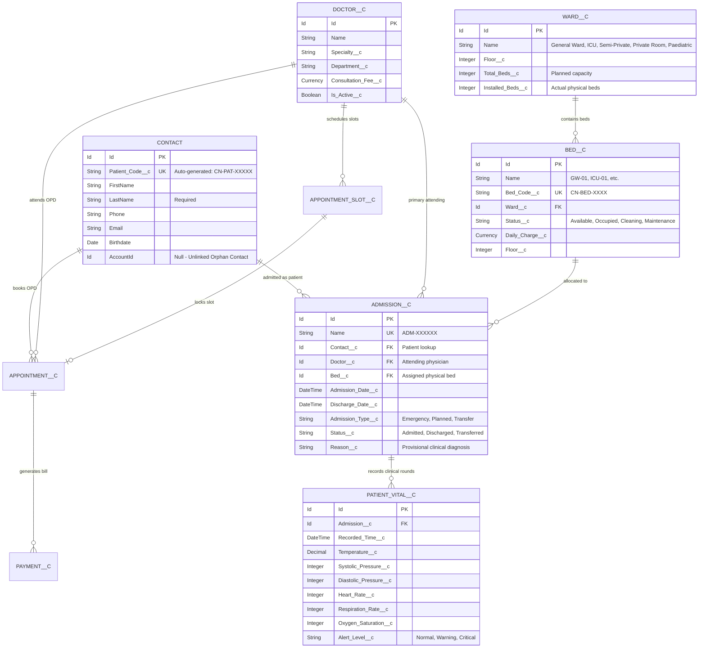

# CareNest HMS — Enterprise System Architecture & Data Model

**Project:** CareNest Hospital Management System  
**Platform:** Salesforce Lightning Platform (API v68.0)  
**Architecture Paradigm:** Layered Separation of Concerns (SoC) Enterprise Architecture  
**Target Organization ID:** `00Dg700000Cpr9pEAB`  

---

## 1. Architectural Philosophy

CareNest is engineered natively on the Salesforce multi-tenant platform adhering to enterprise design patterns (Martin Fowler / FinancialForce Apex Enterprise Patterns):
* **Presentation Layer (LWC):** Single-page, highly responsive reactive Lightning Web Components operating within standard Lightning Experience container (`/lightning/app/c__CareNest`).
* **Controller Layer (Apex `@AuraEnabled`):** Thin facade controllers managing client serialization, payload validation, and delegating to domain services.
* **Domain & Application Service Layer:** Reusable, transaction-isolated Apex services enforcing transactional boundaries, business logic, concurrency control, and logging.
* **Data Access & Selector Layer:** Secure SOQL query execution adhering to `WITH USER_MODE`, `WITH SECURITY_ENFORCED`, and programmatic row-level sharing.
* **Security & Governance Layer:** Zero-Trust Stage 2 Role-Based Access Control (RBAC), Private Organization-Wide Defaults (OWD), and Apex Managed Sharing.
* **Autonomous AI Layer:** Salesforce Agentforce integration via typed, deterministic `@InvocableMethod` actions with strict medical guardrails.

---

## 2. High-Level Architectural Diagram

```mermaid
graph TD
    subgraph Presentation_Layer["Presentation Layer (Lightning Web Components)"]
        Dash["careNestDashboardV2\n(Executive Command Center & Navigation)"]
        PatWS["patientAdmissionWorkspace\n(Patient Intake Registry & 6-Step Admission Wizard)"]
        ClinWS["inpatientClinicalWorkspace\n(Telemetry, Vitals, Alerts & Bedside Rounds)"]
        WardMgr["wardBedManager\n(Interactive Bed Matrix & Capacity Rollups)"]
        DocDir["doctorSearch & appointmentWizard\n(Physician Roster & OPD Scheduling)"]
        Billing["patientBilling\n(POS Counter Collections & Invoices)"]
        AIAssist["agentforceAssistantWidget\n(Clinical AI Copilot Interface)"]
        AdminHub["adminOverview & Reports Hub\n(16 Certified Lightning Reports & Analytics)"]
    end

    subgraph Service_Layer["Domain & Application Service Layer"]
        S_Adm["CareNestAdmissionController\n& CareNestPatientAccessService"]
        S_Appt["AppointmentService\n(Concurrency: SELECT ... FOR UPDATE)"]
        S_Canc["CancellationService\n(Tiered Custom Metadata Refund Policy)"]
        S_Clin["ClinicalDocumentationService\n(Vital Signs Normal Range Telemetry)"]
        S_Share["CareNestPatientSharingService\n(Programmatic Row-Level Sharing)"]
        S_Log["ErrorLogService\n(Decoupled Platform Event Audit Logger)"]
    end

    subgraph Agentforce_AI["Agentforce Autonomous Invocable Actions"]
        Bot["CareNest Clinical Assistant\n(Agentforce Employee Agent)"]
        Act_Doc["DoctorSearchAction"]
        Act_Bed["WardAvailabilityAction"]
        Act_Appt["AppointmentStatusAction"]
        Act_Canc["CancelAppointmentAction"]
    end

    subgraph Data_Storage["Data Storage Layer (Private OWD)"]
        Contact["Contact\n(Patient Master Index)"]
        Doctor["Doctor__c\n(Staff Directory)"]
        Slot["Appointment_Slot__c\n(OPD Capacity)"]
        Appt["Appointment__c\n(Consultation Encounters)"]
        Payment["Payment__c\n(Counter Collections)"]
        Ward["Ward__c\n(Departmental Units)"]
        Bed["Bed__c\n(Physical Bed Inventory)"]
        Admission["Admission__c\n(Inpatient Episode of Care)"]
        Vital["Patient_Vital__c\n(Telemetry & Observations)"]
        ErrorLog["Error_Log__c\n(Audit Trail)"]
    end

    Dash --> PatWS & ClinWS & WardMgr & DocDir & Billing & AIAssist & AdminHub
    PatWS --> S_Adm & S_Share
    DocDir --> S_Appt & S_Canc
    ClinWS --> S_Clin
    AIAssist --> Bot
    Bot --> Act_Doc & Act_Bed & Act_Appt & Act_Canc
    Act_Doc & Act_Bed & Act_Appt & Act_Canc --> S_Appt & S_Adm
    S_Adm --> Ward & Bed & Admission & Contact
    S_Appt & S_Canc --> Slot & Appt & Payment
    S_Clin --> Vital
    S_Share --> Contact & Admission
    S_Log --> ErrorLog
```

---

## 3. Entity-Relationship Data Model

CareNest maintains a normalized data schema with strict referential integrity:

---

## 4. Key Architectural Patterns & Guarantees

### 4.1 Inpatient Admission State Machine & Concurrency Protection
* **Pessimistic Bed Locking:** When an admission is initiated, bed availability is re-evaluated using `SELECT Id, Status__c FROM Bed__c WHERE Id = :bedId FOR UPDATE`.
* **State Machine Guard:** A bed cannot transition from `Available` to `Occupied` if an active admission (`Status__c = 'Admitted'`) already references it.
* **Occupancy Rollup Synchronization:** Custom Apex triggers and rollups instantly recalculate ward occupancy metrics and notify UI components via reactive refresh adapters (`refreshApex`).

### 4.2 Outpatient Concurrency & Tiered Cancellation Policy
* **Double-Booking Prevention:** Appointment slot selection utilizes pessimistic row locks (`SELECT Id, Status__c FROM Appointment_Slot__c WHERE Id = :slotId FOR UPDATE`). If two users attempt to book the same slot simultaneously, the second transaction is safely rolled back with a deterministic user-facing concurrency message.
* **Custom Metadata Tiered Refund Engine:** Outpatient cancellations reference `CareNest_Cancellation_Rule__mdt` records:
  * Cancelled $> 24$ hours before appointment: $100\%$ refund.
  * Cancelled $12 - 24$ hours before appointment: $50\%$ refund.
  * Cancelled $< 12$ hours before appointment: $0\%$ refund.

### 4.3 Zero-Trust Security & Unlinked Orphan Patient Isolation
* **Orphan Contact Architecture:** Patient contacts are intentionally created with `AccountId = null`. This isolates patient health records from commercial CRM standard account hierarchy sharing rules.
* **Stage 2 Zero-Trust RBAC:** Enforces Organization-Wide Defaults (OWD) set to **Private** for all custom healthcare objects (`Doctor__c`, `Ward__c`, `Bed__c`, `Admission__c`, `Patient_Vital__c`, `Payment__c`).
* **Apex Managed Sharing:** Clinicians and nurses receive explicit row-level sharing (`Admission__Share`, `Patient_Vital__Share`) strictly based on their ward assignments or attending physician relationship.
