# CareNest — System Architecture & Solution Design

## 1. Architectural Philosophy

CareNest is built as an enterprise-grade Hospital Management System (HMS) natively on the Salesforce Lightning Platform. It is engineered around principles of modular separation of concerns, concurrency control, defense-in-depth data governance, and event-driven automation.

Rather than fragmenting clinical and administrative functions into disparate third-party systems or disconnected Salesforce apps, CareNest unifies 12 essential hospital operational modules into a single, high-performance command center while strictly enforcing Least Privilege Role-Based Access Control (RBAC).

---

## 2. High-Level Solution Architecture

```mermaid
graph TD
    subgraph UI_Layer["Presentation Layer (Lightning Experience & LWCs)"]
        Nav["Unified Branded Navigation Header"]
        M1["Module 1: Command Center Telemetry"]
        M2["Module 2: Patient Registry Workspace"]
        M3["Module 3: Doctors & Staff Directory"]
        M4["Module 4: Outpatient Appointment Wizard"]
        M5["Module 5: Inpatient Admissions & Discharges"]
        M6["Module 6: Ward & Bed Capacity Manager"]
        M7["Module 7: Clinical Chart & Vitals Workspace"]
        M8["Module 8: Agentforce AI Hospital Assistant"]
        M9["Module 9: Reports & Analytics Hub (16 Reports)"]
        M10["Module 10: Cashier Desk & Patient Billing"]
        M11["Module 11: Automation & Batch Engine"]
        M12["Module 12: System Health & RBAC Audit"]
    end

    subgraph Controller_Layer["Apex Controller & Orchestration Layer"]
        C_Dash["CareNestDashboardController"]
        C_Adm["CareNestAdmissionController"]
        C_Appt["CareNestAppointmentController"]
        C_Ward["CareNestWardBedController"]
        C_Clin["CareNestClinicalController"]
        C_Agent["CareNestAssistantUIController"]
        C_Doc["DoctorSearchController"]
    end

    subgraph Service_Layer["Apex Domain & Application Services"]
        S_Appt["AppointmentService\n(Concurrency Lock: SELECT ... FOR UPDATE)"]
        S_Canc["CancellationService\n(Tiered Policy Engine via Custom Metadata)"]
        S_Adm["AdmissionService\n(Bed State Machine & Admission Lifecycle)"]
        S_Clin["ClinicalDocumentationService\n(Encounter & Vital Sign Validation)"]
        S_Share["CareNestPatientAccessService & ClinicalSharingService\n(Programmatic Apex Sharing)"]
        S_Err["ErrorLogService\n(Platform Event-Driven Exception Logging)"]
    end

    subgraph Async_Layer["Asynchronous Batch & Event Layer"]
        B_NoShow["NoShowBatch\n(Auto-detect missed consultations)"]
        B_Expiry["PendingExpiryBatch\n(Auto-release unpaid slots)"]
        B_Recon["CrossCoverReconciliationBatch\n(Sync temporary staff ward sharing)"]
        Q_Sms["ReminderSmsJob\n(Idempotent Queueable SMS notifications)"]
        E_Log["Error_Log_Event__e\n(Platform Event for decoupled logging)"]
    end

    subgraph Data_Layer["Data & Security Layer (Salesforce Database)"]
        Contact["Contact (Patient)"]
        Doctor["Doctor__c"]
        Slot["Appointment_Slot__c"]
        Appt["Appointment__c"]
        Payment["Payment__c"]
        Cancel["Cancellation__c"]
        Ward["Ward__c"]
        Bed["Bed__c"]
        Adm["Admission__c"]
        Enc["Inpatient_Encounter__c"]
        Vital["Patient_Vital__c"]
        StaffWard["CareNest_Staff_Ward_Assignment__c"]
        Metadata["Cancellation_Policy__mdt"]
    end

    Nav --> M1 & M2 & M3 & M4 & M5 & M6 & M7 & M8 & M9 & M10 & M11 & M12
    M1 & M9 --> C_Dash
    M2 & M5 --> C_Adm
    M3 & M4 --> C_Appt & C_Doc
    M6 --> C_Ward
    M7 --> C_Clin
    M8 --> C_Agent
    M10 --> C_Appt

    C_Dash --> S_Share
    C_Adm --> S_Adm & S_Share
    C_Appt & C_Doc --> S_Appt & S_Canc
    C_Ward --> S_Adm
    C_Clin --> S_Clin & S_Share
    C_Agent --> S_Appt & S_Adm

    S_Appt --> Appt & Slot & Doctor
    S_Canc --> Cancel & Metadata & Appt
    S_Adm --> Adm & Bed & Ward
    S_Clin --> Vital & Enc
    S_Share --> Contact & Adm
    S_Err --> E_Log
    E_Log --> S_Err

    B_NoShow --> Appt
    B_Expiry --> Appt & Slot
    B_Recon --> S_Share
    Q_Sms --> Appt
```

---

## 3. Layered Design Breakdown

### 3.1 Presentation Layer (Lightning Web Components)
- **Container Architecture:** Hosted in `CareNest_Home_V2.flexipage`, embedding the primary controller component `careNestDashboardV2`.
- **Component Decoupling:** Reusable sub-components (`appointmentWizard`, `wardBedManager`, `patientAdmissionWorkspace`, `inpatientClinicalWorkspace`, `doctorSearch`, `agentforceAssistantWidget`, `patientBilling`, `patientRegistrationModal`) communicate through Lightning Message Service (`CareNestMessageChannel`) and standard CustomEvent dispatching.
- **Client-Side Responsiveness:** CSS grid and flexbox breakpoints dynamically adapt across desktop (>1024px), tablet (641px–1024px), and mobile (≤640px) viewport form factors.

### 3.2 Apex Domain & Service Layer
- **Trigger Framework:** Implements the `TriggerHandler` pattern across 7 triggers (`AdmissionTrigger`, `AppointmentTrigger`, `BedTrigger`, `DoctorTrigger`, `ErrorLogEventTrigger`, `InpatientEncounterTrigger`, `PatientVitalTrigger`). Triggers contain no business logic; they route to dedicated handler classes.
- **Concurrency Locking (`SELECT ... FOR UPDATE`):** When booking appointments or allocating inpatient beds, database rows are locked in memory until transaction commit. This eliminates race conditions and double-booking bugs during high-concurrency peak clinic hours.
- **Custom Metadata-Driven Business Logic:** Cancellation fee tiers and refund percentages are decoupled from Apex code into `Cancellation_Policy__mdt`, allowing hospital administrators to adjust financial policies without modifying code or triggering deployments.
- **Platform Event Exception Logging:** Unhandled exceptions and transactional errors publish `Error_Log_Event__e` platform events, which subscribe asynchronously in an autonomous execution context. This guarantees that error audit records are committed even if the primary database transaction rolls back.

### 3.3 Security & Data Isolation Layer
- **Organization-Wide Defaults (OWD):** Sensitive healthcare objects (`Contact`, `Admission__c`, `Patient_Vital__c`, `Inpatient_Encounter__c`, `Payment__c`) are configured as **Private**.
- **Role-Based Access Control (RBAC):** Access is governed by 9 dedicated Permission Sets:
  1. `CareNest_Admin`: Full administrative, operational, and financial command center privileges.
  2. `CareNest_Doctor`: Attending physician access to assigned patients, clinical documentation, and rounds.
  3. `CareNest_Nurse`: Ward management, bedside vitals recording, and clinical alert acknowledgment.
  4. `CareNest_Front_Desk`: Outpatient registration, doctor search, and appointment scheduling.
  5. `CareNest_Ops_Manager`: Capacity balancing, ward management, and operational reporting.
  6. `CareNest_Ward_Management`: Specialized bed state and ward bed count administration.
  7. `CareNest_Patient`: Patient portal self-service booking, history view, and cancellation.
  8. `CareNest_Agent_Actions`: Permission for Agentforce AI agents to execute invocable actions.
  9. `CareNest_Integration`: API service integration and telemetry feed.
- **Programmatic Apex Sharing:** Attending doctors and assigned ward nurses receive row-level sharing to admitted patient records dynamically via `CareNestPatientAccessService` and `ClinicalSharingService`. Temporary cross-cover ward assignments are synchronized via `CrossCoverReconciliationBatch`.
- **Zero Cross-Project Contamination:** Multi-tenant boundaries strictly isolate CareNest hospital data from legacy or adjacent org projects (such as MiniCare), enforcing verified provenance across patient IDs, reports, and financial rollups.
