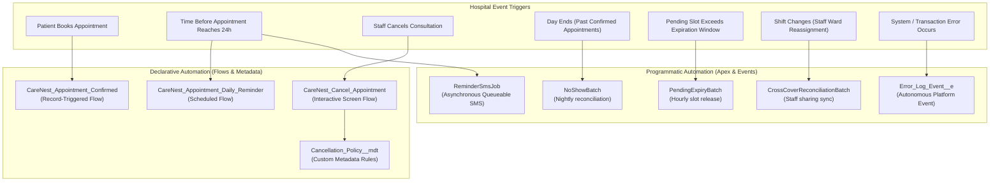

# CareNest — Automation, Flows & Event-Driven Architecture

## 1. Declarative & Programmatic Automation Mix

CareNest strategically combines Salesforce declarative tools (Record-Triggered Flows, Screen Flows, Custom Metadata) with programmatic automation (Apex Batch Jobs, Schedulables, Queueables, Platform Events) following the "Code where necessary, Declarative where beneficial" principle.



---

## 2. Salesforce Flows

### 2.1 `CareNest_Appointment_Confirmed` (Record-Triggered Flow)
- **Trigger Condition:** Executes after an `Appointment__c` record is created or updated with `Status__c = 'Scheduled'`.
- **Actions Executed:**
  1. Verifies that the patient's phone and email are populated on the parent `Contact`.
  2. Creates a welcome notification task for the front desk coordinator.
  3. Enqueues an automated confirmation notification.
  4. Updates the related `Appointment_Slot__c` telemetry fields.

### 2.2 `CareNest_Appointment_Daily_Reminder` (Scheduled Flow)
- **Execution Schedule:** Runs daily at 07:00 AM.
- **Criteria:** Identifies all appointments scheduled for the following calendar day where `Status__c = 'Scheduled'` and `Reminder_Sent__c = false`.
- **Actions Executed:**
  1. Enqueues the Queueable worker `ReminderSmsJob.cls` passing appointment record IDs.
  2. Sets `Reminder_Sent__c = true` and logs the reminder timestamp.

### 2.3 `CareNest_Cancel_Appointment` (Screen Flow)
- **Purpose:** Guided front desk and clinician screen flow for executing patient or hospital-initiated cancellations.
- **Workflow:**
  1. Prompts the user to select the cancellation reason (Medical Emergency, Patient Request, Clinician Rescheduled).
  2. Calls the Invocable Apex action `CancelAppointmentAction.cls`.
  3. Displays a real-time summary card detailing notice hours, refund entitlement, and cancellation fee breakdown.

---

## 3. Custom Metadata-Driven Policy Engine

Rather than hardcoding business rules or fee percentages in Apex code, CareNest utilizes Custom Metadata Type `Cancellation_Policy__mdt`:

| Developer Name | Min Notice Hours | Max Notice Hours | Refund Percentage | Cancellation Fee Percentage |
|---|:---:|:---:|:---:|:---:|
| `More_Than_24_Hours` | 24 | 9999 | 100% | 0% |
| `Between_4_And_24_Hours` | 4 | 24 | 75% | 25% |
| `Under_4_Hours` | 0 | 4 | 0% | 100% |

**Architectural Advantage:** Enables non-developer clinic administrators to modify hospital refund policies directly in production setup without requiring Apex refactoring, test suite updates, or formal metadata deployments.

---

## 4. Asynchronous Apex Engines

### 4.1 Scheduled Batch Framework
- **`NoShowBatch.cls`:**
  - Automated attendance reconciliation batch executing nightly at 23:00.
  - Queries:
    ```sql
    SELECT Id, Status__c, Slot__r.Slot_Start__c, 
           (SELECT Id FROM Visit_Records__r)
    FROM Appointment__c
    WHERE Status__c = 'Scheduled' 
      AND Slot__r.Slot_Start__c < :System.now()
    ```
  - For any past appointment lacking a child `Visit_Record__c`, it marks the record `No Show`.
- **`PendingExpiryBatch.cls`:**
  - Hourly batch worker reclaiming abandoned slots.
  - Automatically expires unpaid pending bookings older than the configured threshold (e.g. 2 hours) and decrements the slot's `Booked_Count__c`.
- **`CrossCoverReconciliationBatch.cls`:**
  - Daily synchronization of temporary staff ward assignments (`CareNest_Staff_Ward_Assignment__c`).
  - Ensures nurses and cross-covering physicians receive access to patients in assigned wards and automatically revokes access when the assignment expires.

### 4.2 Queueable Notification Worker (`ReminderSmsJob.cls`)
- **Idempotency Safeguard:** Generates an MD5 signature of `appointmentId + slotStartTime` before dispatching messages, preventing duplicate patient SMS alerts if retries occur.
- **Governor Limit Protection:** Chained queueables chunk notification requests into batches of 50 to respect callout and transaction limits.

---

## 5. Decoupled Exception Logging via Platform Events

Traditional Apex `try-catch` blocks that insert database log records face a fundamental flaw: if the primary transaction fails and rolls back, the inserted log record is rolled back too, leaving zero diagnostic evidence.

CareNest eliminates this issue using Salesforce Platform Events:

```
[ Apex Transaction Encountering Exception ]
                   │
                   ▼
     [ ErrorLogService.logException() ]
                   │
                   ▼
  [ Publish Error_Log_Event__e (Immediate) ]
                   │
                   ▼
┌──────────────────────────────────────────────────┐
│      Salesforce Event Bus (Autonomous Queue)     │
└──────────────────────────────────────────────────┘
                   │
                   ▼
   [ ErrorLogEventTrigger (Separate Context) ]
                   │
                   ▼
    [ Insert Error_Log__c (Committed Safely) ]
```

Because `Error_Log_Event__e` is configured with `PublishImmediately`, events published via `EventBus.publish()` are dispatched immediately to the event bus and are not rolled back if the publishing Apex transaction subsequently issues a `Database.rollback(sp)`. The asynchronous subscriber trigger (`ErrorLogEventTrigger`) running under the Automated Process context sanitizes the message and inserts `Error_Log__c` records out-of-transaction (subject to standard platform event delivery and trigger execution limits).
