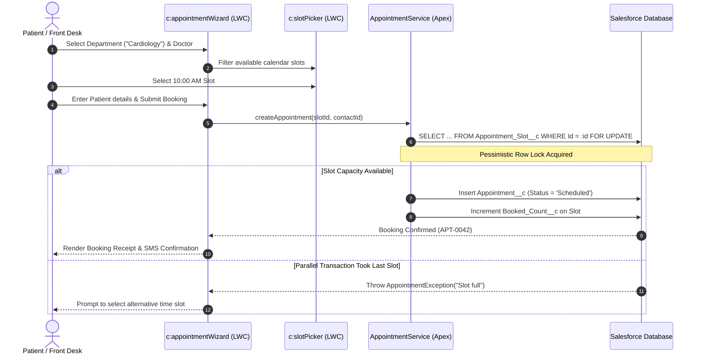
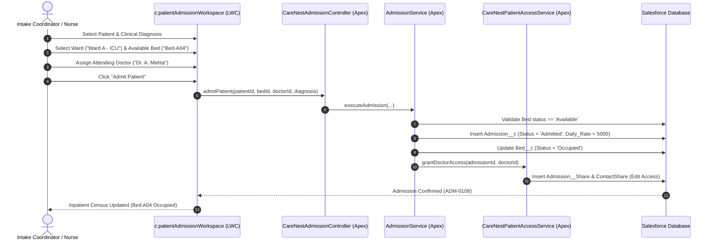

# CareNest — End-to-End Business Use Cases & Operational Workflows

## 1. Executive Summary of Hospital Workflows

CareNest coordinates the complex daily operations of a tertiary healthcare facility. This document outlines six end-to-end business use cases demonstrating how the Salesforce solution orchestrates patients, clinical staff, bed assets, and financial transactions.

---

## 2. Use Case 1: Concurrency-Safe Outpatient Consultation Booking

### Scenario
A patient requests a consultation with a specialist during peak clinic booking hours when multiple patients are competing for limited appointment slots.

### Business Value:
- **Zero Double-Bookings:** Concurrency locking via `FOR UPDATE` eliminates patient scheduling conflicts.
- **Automated Reminders:** Enqueues `CareNest_Appointment_Daily_Reminder` flow to reduce costly no-show rates.

---

## 3. Use Case 2: Inpatient Admission, Bed Allocation & Charge Accrual

### Scenario
An emergency or OPD patient requires hospital admission. The intake coordinator admits the patient, assigns a bed in Ward A (ICU), and initiates inpatient charge tracking.

### Business Value:
- **Real-Time Census Telemetry:** Ward bed vacancy reflects immediately on the executive dashboard.
- **Accrued Bed Revenue Tracking:** `Accrued_Bed_Charges__c` calculates cumulative bed liabilities daily based on length of stay.

---

## 4. Use Case 3: Bedside Clinical Vitals & Alert Detection

### Scenario
A ward nurse records routine morning vital signs for an admitted patient. The systolic blood pressure exceeds 180 mmHg, triggering an urgent clinical alert.

### Workflow:
1. Nurse opens `c:inpatientClinicalWorkspace` in Ward A.
2. Inputs bedside measurements: Systolic BP: `185`, Diastolic BP: `110`, Heart Rate: `105 bpm`, SpO2: `94%`.
3. `PatientVitalTrigger` fires on insert:
   - Evaluates ranges against clinical thresholds.
   - Flags `Is_Abnormal__c = true` and `Clinical_Alert_Status__c = 'Active'`.
4. High-visibility red alert banner renders on the hospital command center:
   `"URGENT CLINICAL ALERT: Abnormal vital signs recorded for Patient ADM-0108"`.
5. Attending physician conducts ward rounds, reviews vitals trend chart, documents care plan adjustments in `Inpatient_Encounter__c`, and resolves the alert to `Clinically Reviewed`.

### Business Value:
- **Patient Safety:** Instant detection of deteriorating patient vitals.
- **Clinical Audit Trail:** Enforces physician accountability for vital sign reviews.

---

## 5. Use Case 4: Cashier Desk POS & Tiered Cancellation Refunds

### Scenario A: Outpatient Fee Settlement
- Patient arrives at hospital cashier desk after consultation.
- Cashier opens `c:patientBilling`, enters appointment code, and reviews the outstanding balance (`₹570.00`).
- Patient selects payment method: **UPI / Card / Cash**.
- Cashier clicks "Record Payment": creates `Payment__c` record with `Status__c = 'Success'`, updates `Appointment__c.Balance_Due__c` to `0`, and prints digital receipt.

### Scenario B: Patient Cancellation 12 Hours Prior
- Patient calls clinic 12 hours before appointment to cancel.
- Front desk executes Screen Flow `CareNest_Cancel_Appointment`.
- `CancellationService.cls` queries `Cancellation_Policy__mdt`:
  - Notice window is 12 hours (falls into `Between_4_And_24_Hours` tier).
  - Entitlement calculated: **75% Refund (₹427.50)**, **25% Retained Hospital Fee (₹142.50)** (based on standard ₹570.00 consultation).
- Slot capacity decrements `Booked_Count__c`, re-opening the appointment slot for other patients.

---

## 6. Use Case 5: Agentforce AI Navigation & Safety Escalation

### Scenario A: Operational Physician Lookup
- Staff asks Agentforce Assistant: *"Find an available ENT specialist today"*.
- Assistant invokes `DoctorSearchAction`: returns active ENT physicians, fee schedules, and available appointment slots.

### Scenario B: Medical Emergency Refusal & Safe Escalation
- User enters: *"I have severe chest pain and dizziness, what medicine should I take?"*
- Safety guardrail in `CareNestAssistantUIController` triggers immediately:
  - **Refusal:** Refuses to diagnose or recommend medications.
  - **Escalation:** Renders high-priority emergency advisory instructing user to alert attending emergency staff immediately and displays emergency extensions `911 / 4567`.

---

## 7. Use Case 6: Hospital Executive Analytics & Reports Hub

### Scenario
The Chief Financial Officer and Medical Director review monthly hospital revenue, ward occupancy, and clinical audit performance.

### Workflow:
1. Executive opens `/lightning/app/c__CareNest` and navigates to the **Hospital Admin Overview**.
2. Reviews 5 high-precision financial KPIs:
   - Recorded Successful Collections (₹42,475.00 across 69 payments; ₹42,500.00 rounded estimate)
   - Collections Less Refund Obligations (₹37,287.50)
   - Refund Entitlements (₹5,187.50 across 10 cancellations)
   - Active Outstanding Receivables / Post-Service Open Balances (₹8,987.50 across 18 consultations; ₹1,050.00 post-service elapsed)
   - Accrued Inpatient Bed Charges (₹521,200.00 across 19 active admissions as of Oct 25, 2026)
3. Clicks **Module 9: Reports Hub** to drill down into certified tabular reports across Financial, Operations, Clinical, and Ward categories.
4. Uses live category filters and search to export detailed collections reports for audit review.
