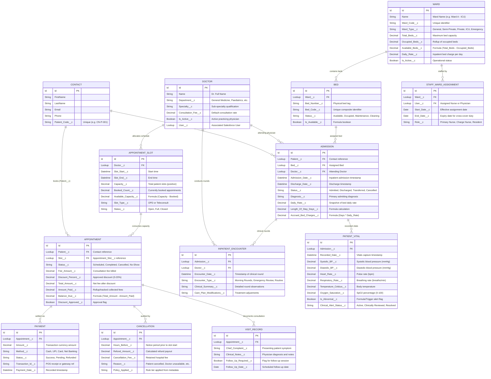

# CareNest — Data Model & Entity Relationship Guide

## 1. Entity-Relationship Overview

The CareNest data model is structured around two interconnected operational lifecycles:
1. **Outpatient Consultation Lifecycle (OPD):** Patient (`Contact`) → `Doctor__c` → `Appointment_Slot__c` → `Appointment__c` → `Payment__c` / `Cancellation__c` / `Visit_Record__c`.
2. **Inpatient Admission & Clinical Lifecycle (IPD):** `Ward__c` → `Bed__c` → `Admission__c` → `Inpatient_Encounter__c` & `Patient_Vital__c`.

---

## 2. Custom Object Dictionary

| Object API Name | Standard / Custom | Description | Sharing Model | Key Relationships |
|---|---|---|---|---|
| `Contact` | Standard | Hospital Patient Master Record | Private | Child of Account (or Individual) |
| `Doctor__c` | Custom | Outpatient and Inpatient Physicians | Public Read/Write | Master to Appointment Slots |
| `Appointment_Slot__c` | Custom | Time slots allocated by doctor schedule | ControlledByParent | Master-Detail (`Doctor__c`) |
| `Appointment__c` | Custom | Consultation bookings and billing summary | Private | Lookup (`Contact`), Lookup (`Appointment_Slot__c`) |
| `Payment__c` | Custom | Cash, Card, UPI payment records | ControlledByParent | Master-Detail (`Appointment__c`) |
| `Cancellation__c` | Custom | Audit log for cancelled appointments & refunds | ControlledByParent | Master-Detail (`Appointment__c`) |
| `Visit_Record__c` | Custom | Post-consultation clinical encounter note | ControlledByParent | Master-Detail (`Appointment__c`) |
| `Ward__c` | Custom | Hospital wards (ICU, General, etc.) | Public Read Only | Master to Beds |
| `Bed__c` | Custom | Individual hospital beds within a ward | ControlledByParent | Master-Detail (`Ward__c`) |
| `Admission__c` | Custom | Inpatient admission records & census | Private | Lookup (`Contact`), Lookup (`Bed__c`), Lookup (`Doctor__c`) |
| `Inpatient_Encounter__c` | Custom | Daily physician ward rounds & progress notes | ControlledByParent | Master-Detail (`Admission__c`), Lookup (`Doctor__c`) |
| `Patient_Vital__c` | Custom | Physiological bedside vital signs & alert telemetry | ControlledByParent | Master-Detail (`Admission__c`) |
| `CareNest_Staff_Ward_Assignment__c` | Custom | Staff cross-cover ward assignments for Apex sharing | Private | Lookup (`Ward__c`), Lookup (`User`) |
| `Error_Log__c` | Custom | Persistent exception and transactional error log | Private | Standalone |
| `Error_Log_Event__e` | Platform Event | High-volume platform event for decoupled logging | N/A | Standalone event payload |
| `Cancellation_Policy__mdt` | Custom Metadata | Governed tiers for notice hours, refund %, and fee % | Public Read | Standalone metadata |

---

## 3. Data Integrity & Validation Rules

CareNest enforces 30 declarative validation rules directly on the database engine to guarantee medical, operational, and financial data consistency:

### 3.1 Admission & Bed Rules
1. `Admission__c.Patient_Required`: Prevents admissions without a linked Patient (`Contact`).
2. `Admission__c.Doctor_Required`: Requires an attending physician on all inpatient admissions.
3. `Admission__c.Bed_Required`: Ensures an admission is physically allocated to a valid `Bed__c`.
4. `Admission__c.Discharge_After_Admission`: Disallows discharge dates that precede admission dates.
5. `Bed__c.Ward_Required`: Enforces that beds must belong to an active parent ward.
6. `Bed__c.Bed_Number_Required`: Mandates physical bed identification tags.
7. `Bed__c.Bed_Code_Required`: Requires unique composite bed identifiers.
8. `Bed__c.Cannot_Add_Bed_To_Inactive_Ward`: Prevents adding beds to decommissioned wards.
9. `Ward__c.Ward_Code_Required`: Mandates unique clinical ward codes.
10. `Ward__c.Capacity_Must_Be_Positive`: Restricts ward bed capacity to positive integers.
11. `Ward__c.Capacity_Cannot_Be_Less_Than_Bed_Count`: Prevents reducing capacity below existing bed counts.

### 3.2 Outpatient & Appointment Rules
12. `Appointment__c.Patient_Required`: Enforces patient contact link on all bookings.
13. `Appointment__c.Unapproved_Discount_Not_Allowed`: Rejects discounts greater than 0% without approval flag.
14. `Appointment__c.Discount_Above_20_Not_Allowed`: Restricts max discount to 20% even with approval.
15. `Appointment_Slot__c.Capacity_Must_Be_Positive`: Ensures slot capacity is at least 1.
16. `Appointment_Slot__c.Slot_Must_Be_Future`: Prevents scheduling slots in the past.
17. `Visit_Record__c.Follow_Up_Date_Required`: Requires a date if follow-up flag is checked.

### 3.3 Clinical Documentation & Vitals Range Checks
18. `Inpatient_Encounter__c.Admission_Required`: Requires active admission link.
19. `Inpatient_Encounter__c.Doctor_Required`: Mandates clinician attribution on rounds.
20. `Inpatient_Encounter__c.Encounter_Date_Required`: Enforces encounter timestamp.
21. `Inpatient_Encounter__c.Prevent_Encounter_On_Inactive_Admission`: Rejects rounds on discharged patients.
22. `Patient_Vital__c.Admission_Required`: Mandates admission parent link.
23. `Patient_Vital__c.Prevent_Vitals_On_Inactive_Admission`: Disallows vitals logging post-discharge.
24. `Patient_Vital__c.Recorded_Date_Required`: Requires explicit timestamp.
25. `Patient_Vital__c.Valid_Blood_Pressure`: Checks systolic (50-250 mmHg) and diastolic (30-150 mmHg).
26. `Patient_Vital__c.Valid_Pulse_Range`: Restricts heart rate between 30 and 220 bpm.
27. `Patient_Vital__c.Valid_Respiratory_Rate_Range`: Validates respiration between 6 and 60 breaths/min.
28. `Patient_Vital__c.Valid_Temperature_Range`: Enforces human temperature range (34.0°C to 43.0°C).
29. `Patient_Vital__c.Valid_Oxygen_Saturation_Range`: Validates SpO2 percentage between 50% and 100%.
30. `Patient_Vital__c.Valid_Weight_Range`: Restricts weight between 1.0 kg and 400.0 kg.
