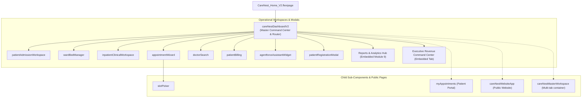

# CareNest — Lightning Web Components (LWC) Architecture

## 1. Overview & Component Catalog

The CareNest user interface is built natively using modern Salesforce Lightning Web Components (LWC). Rather than relying on legacy Visualforce or heavy Aura components, CareNest uses lightweight reactive web components utilizing standard Shadow DOM encapsulation, custom events, and the Lightning Message Service (LMS).



---

## 2. Complete LWC Catalog (14 Components)

| # | Component Name | Primary Role | Key Apex Controllers & Wire Services | Communication Mechanism |
|---|---|---|---|---|
| 1 | `careNestDashboardV2` | Master Hospital Command Center, Executive Analytics, and Module Router. | `CareNestDashboardController` (`getDashboardMetrics`, `getReportsHubReports`, `getWardSummaries`, `getRecentActivities`) | Top-level orchestrator; active tab state management. |
| 2 | `appointmentWizard` | 4-step outpatient booking wizard (Department, Doctor & Slot, Patient, Review). | `DoctorSearchController` (`bookAppointment`, `searchPatients`) | Dispatches booking completion events; embeds `slotPicker`. |
| 3 | `slotPicker` | Reactive date-filtered calendar slot picker displaying real-time availability. | `DoctorSearchController` (`getAvailableSlots`) | Receives doctor selection via LMS; fires `slotselect` CustomEvent. |
| 4 | `doctorSearch` | Searchable clinician directory with specialty filters and fee badges. | `DoctorSearchController` (`searchDoctors`) | Publishes `doctorSelected` event via LMS (`CareNestMessageChannel`). |
| 5 | `patientAdmissionWorkspace` | Inpatient intake wizard, attending doctor assignment, and bed selection. | `CareNestAdmissionController` (`admitPatient`, `dischargePatient`, `getActiveAdmissions`) | Emits admission status change events; refreshes census. |
| 6 | `wardBedManager` | Interactive hospital floor plan managing ward capacities and bed statuses. | `CareNestWardBedController` (`getWardsWithBeds`, `updateBedStatus`) | Real-time bed status updates (`Available`, `Occupied`, `Cleaning`). |
| 7 | `inpatientClinicalWorkspace` | Attending clinician chart for bedside vitals, alerts, and encounter notes. | `CareNestClinicalController` (`getPatientClinicalSummary`, `recordVitals`, `logEncounter`) | Clinical alert resolution triggers; vitals validation. |
| 8 | `agentforceAssistantWidget` | Interactive AI copilot modal with suggested topics and clinical guardrails. | `CareNestAssistantUIController` (`processQuery`) | Two-way conversational interface; invokes Agentforce actions. |
| 9 | `patientBilling` | Cashier desk POS modal supporting simulated Cash, Card, and UPI payments. | `CareNestAppointmentController` (`getUnpaidAppointments`, `recordPayment`) | Dispatches receipt generation and payment status sync. |
| 10 | `patientRegistrationModal` | Rapid patient demographic intake modal with duplicate prevention. | `CareNestAdmissionController` (`createPatient`) | Modal popup; passes new Contact ID back to parent workspace. |
| 11 | `myAppointments` | Patient-facing self-service appointment list with cancellation dialogs. | `DoctorSearchController` (`getMyAppointments`), `CancellationService` | Portal self-service; cancellation policy modal. |
| 12 | `hospitalOperationsDashboard` | Legacy operations KPI overview (preserved for backwards compatibility). | `CareNestDashboardController` | Read-only telemetry display. |
| 13 | `careNestMasterWorkspace` | Full-width multi-tab administrative workspace container. | Orchestration layer | Tab switching and session state. |
| 14 | `careNestWebsiteApp` | Public responsive clinic website with online booking and doctor discovery. | `DoctorSearchController` | Public guest user booking flow. |

---

## 3. Key Technical Implementations

### 3.1 Lightning Message Service (LMS)
Components communicate across the DOM tree without tight coupling using `CareNestMessageChannel.messageChannel-meta.xml`:
- When a user filters or clicks a doctor card in `c-doctor-search`, it publishes a message containing `doctorId` and `department`.
- `c-slotPicker` subscribes to the channel, automatically refreshing its slot calendar for that specific doctor.

```javascript
// Publishing doctor selection in doctorSearch.js
import { publish, MessageContext } from 'lightning/messageService';
import CARENEST_CHANNEL from '@salesforce/messageChannel/CareNestMessageChannel__c';

handleDoctorClick(event) {
    const doctorId = event.currentTarget.dataset.id;
    publish(this.messageContext, CARENEST_CHANNEL, {
        doctorId: doctorId,
        source: 'doctorSearch'
    });
}
```

### 3.2 Reports Hub Module 9 Reactive Architecture
Inside `careNestDashboardV2`:
- **Server Data Ingestion:** Wires `@AuraEnabled getReportsHubReports` on mount.
- **Client-Side Instant Search:** Filter predicates match search tokens across report names and descriptions in real time without incurring server round-trips.
- **Category Filter State Machine:** Toggles between `all`, `financial`, `operations`, `clinical`, and `additional` with dynamic CSS active pill classes.
- **Defensive Rendering:** If search yields zero results, an intuitive empty-state graphic renders with a single-click "Clear Search" button.

### 3.3 Responsive Breakpoints & Accessibility
The component bundle (`careNestDashboardV2.css`) implements clean responsive design standards:
- **Desktop (>1024px):** 3-column card grid, side-by-side revenue analytics visualizations (Department Revenue progress distribution at 58% and Post-Service Receivables Aging 4-bucket breakdown at 40%), 5 executive financial KPI cards, and full horizontal utility header.
- **Tablet (641px–1024px):** 2-column card grid, scrollable navigation pill strip with left/right chevron buttons.
- **Mobile (≤640px):** Single-column stacked layout, hamburger navigation drawer, touch-friendly 44px tap targets.
