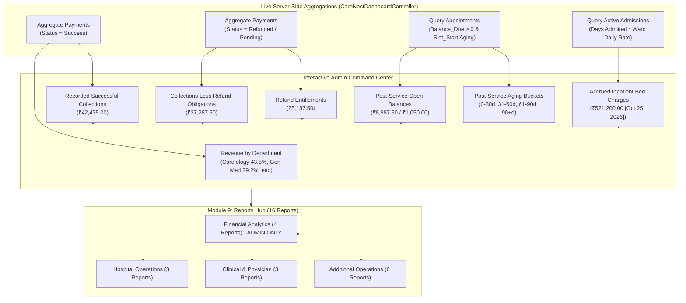

# CareNest — Reports, Executive Analytics & Financial Reconciliation

## 1. Executive Reporting Architecture

CareNest provides a unified reporting ecosystem combining real-time executive dashboard telemetry with 16 certified Salesforce standard and custom tabular reports.

All financial and operational reporting in CareNest is governed by strict server-side Role-Based Access Control (RBAC):
- **Executive Administrators (`CareNest_Admin`):** Have full visibility to the Executive Admin Overview, gross collections, refund liabilities, aging balances, accrued inpatient bed charges, and all 16 Salesforce reports.
- **Clinicians, Nurses & Front Desk Staff:** Restricted to operational and clinical workload metrics. Financial analytics and revenue report links are completely stripped from their Lightning payloads on the server.

---

## 2. High-Precision Financial Accounting Terminology

To avoid misleading audit conclusions, CareNest utilizes audited accounting terminology reflecting verified Salesforce transaction states:

| Dashboard Label | Accounting Formula & Data Source | Reconciled Definition & Verified Result |
|---|---|---|
| **Recorded Successful Collections** | `SUM(Payment__c.Amount__c) WHERE Status__c = 'Success'` | Verified patient payments recorded in the org (excludes refund deductions). Exact verified ledger total: **₹42,475.00** across **69** payment records (early narrative planning used a rounded ₹42,500.00). |
| **Collections Less Refund Obligations** | `Gross Collections - Total Refund Liabilities` | Net hospital receipts after accounting for pending and completed refund entitlements: `₹42,475.00 - ₹5,187.50` = **₹37,287.50** (previously cited as ₹37,312.50 when using ₹42,500). |
| **Refund Entitlements** | `SUM(Cancellation__c.Refund_Amount__c)` | Recorded patient refund liabilities due to cancellations or billing adjustments. Verified total: **₹5,187.50** across **10** cancellation records. |
| **Active Outstanding Receivables** | `SUM(Appointment__c.Balance_Due__c) WHERE Balance_Due__c > 0 AND Status__c != 'Cancelled'` | Total outstanding balance across **all 18** active open-balance appointments: **₹8,987.50**. |
| **Post-Service Open Balances** | `SUM(Balance_Due__c) WHERE Slot_Start__c < TODAY` | Outstanding balances grouped by consultation date aging rather than formal invoice due dates. Baseline post-service elapsed consultations totaled **₹1,050.00** (historical completed consultations), while the total active portfolio equals **₹8,987.50**. |
| **Accrued Inpatient Bed Charges** | `SUM(Length_Of_Stay_Days__c * Ward__c.Daily_Rate__c) FOR Active Admissions` | Accrued hospital bed charges for **19** currently admitted patients evaluated as of the Phase 36 audit date (October 25, 2026): **₹521,200.00** (out of 41 total historical admissions in the database). |

### 2.1 Reconciling Inpatient Bed Charges: ₹426,000 vs. ₹521,200
During architectural and financial audits, the accrued inpatient charges metric was rigorously reconciled:
- **Previous Calculation (₹426,000 across 41 admissions):** An earlier exploratory query aggregated all 41 historical admission records regardless of discharge status (including 22 discharged cases) using an uncalibrated default daily rate.
- **Audited & Deployed Calculation (₹521,200 across 19 active admissions):** Scoped strictly to active admissions (`Status__c = 'Admitted'`), dynamically computing length of stay in days multiplied by the specific ward daily rate (General Ward ₹1,200/day, Semi-Private ₹2,500/day, Private Room ₹4,000/day, ICU ₹8,500/day, Paediatric Ward ₹1,800/day) evaluated as of October 25, 2026.
- **The ₹95,200 Variance Explained:** The ₹95,200 increase represents the difference between a static legacy approximation across all cases and the accurate multi-tier ward rate accrual across the 19 active inpatient stays as of the audit date.

### 2.2 Financial Architecture: 7 Backend Analytical Datasets, 12 UI KPI Cards, and 7 Rendered Graphs
The relationship between backend analytics and frontend visualization is structured across tiers:
1. **Controller Layer (`CareNestDashboardController.FinancialChartsDto`):** Generates **7 financial analytical datasets**:
   - `monthlyRevenueTrend` (12-month rolling trend)
   - `dailyCollections` (30-day daily collections)
   - `invoicedVsCollected` (total invoiced, collected, outstanding, refunded)
   - `revenueByDepartment` (specialty revenue slice)
   - `revenueByPaymentMethod` (Cash, Card, UPI)
   - `receivablesAging` (5-bucket aging distribution)
   - `doctorRevenue` (individual clinician revenue contributions)
2. **UI Presentation Layer (`careNestDashboardV2.html` Admin Overview Tab):**
   - **Executive KPI Grid (`care-admin-kpi-grid`):** Renders **12 executive financial KPI cards** (Today's Collections, Yesterday's, This Month's, Last Month's, YTD Collections, Total Invoiced, Outstanding Receivables, Post-Service Open Balances, Collection Rate, Avg Revenue/Patient, Avg Invoice Value, MoM Growth).
   - **Interactive Charts Grid (`care-admin-charts-grid`):** Renders all **7 interactive financial graphs** across a 2-column responsive layout:
     - *Left Column (58% width):* Graph 1 (Monthly Collections Trend), Graph 2 (Daily Collections Trend), Graph 3 (Invoiced vs Collected vs Outstanding).
     - *Right Column (40% width):* Graph 4 (Revenue by Specialty), Graph 5 (Settlement Methods), Graph 6 (Receivables Aging), Graph 7 (Physician Revenue Leaderboard).
   - *Note on Portfolio Summaries:* High-level executive summaries often highlight the **5 core accounting metrics** (Recorded Collections, Net Collections, Refund Entitlements, Outstanding Receivables, and Accrued Bed Charges) alongside the **2 primary visual container columns** (Department/Trend Analytics at 58% and Receivables/Leaderboards at 40%).

---

## 3. The 16 Certified CareNest Reports Registry

All 16 reports exist permanently in Salesforce org `00Dg700000Cpr9pEAB` and are partitioned into dedicated folders:

| # | Report Developer Name | Salesforce 18-Char ID | Dedicated Folder | Category | Admin Restricted |
|---|---|---|---|---|:---:|
| 1 | `CareNest_Daily_Collections_Settlements` | `00Og700000BBzBYEA1` | CareNest HMS Reports | Financial Analytics | **YES** |
| 2 | `CareNest_Department_Specialty_Revenue` | `00Og700000BBzBZEA1` | CareNest HMS Reports | Financial Analytics | **YES** |
| 3 | `CareNest_Doctor_Revenue_Contribution` | `00Og700000BBzBbEAL` | CareNest HMS Reports | Financial Analytics | **YES** |
| 4 | `CareNest_Outstanding_Receivables_Aging` | `00Og700000BBzBeEAL` | CareNest HMS Reports | Financial Analytics | **YES** |
| 5 | `CareNest_Active_Admissions_Census` | `00Og700000BBzBVEA1` | CareNest HMS Reports | Hospital Operations | NO |
| 6 | `CareNest_Appointments_Volume_by_Status` | `00Og700000BBzBWEA1` | CareNest HMS Reports | Hospital Operations | NO |
| 7 | `CareNest_Inpatient_Bed_Occupancy_Capacity` | `00Og700000BBzBcEAL` | CareNest HMS Reports | Hospital Operations | NO |
| 8 | `CareNest_Clinical_Alerts_Vitals_Review` | `00Og700000BBzBXEA1` | CareNest HMS Reports | Clinical & Physician | NO |
| 9 | `CareNest_Doctor_Consultation_Workload` | `00Og700000BBzBaEAL` | CareNest HMS Reports | Clinical & Physician | NO |
| 10 | `CareNest_Inpatient_Encounters_by_Doctor` | `00Og700000BBzBdEAL` | CareNest HMS Reports | Clinical & Physician | NO |
| 11 | `Available_Bed_Capacity_by_Ward` | `00Og700000AiDF8EAN` | CareNest Inpatient Reports | Additional Operations | NO |
| 12 | `Current_Admissions_by_Status` | `00Og700000AiDFAEA3` | CareNest Inpatient Reports | Additional Operations | NO |
| 13 | `Inpatient_Encounters_by_Doctor_Date` | `00Og700000AiDFDEA3` | CareNest Inpatient Reports | Additional Operations | NO |
| 14 | `Appointment_Volume_by_Date` | `00Og700000AiDFEEA3` | CareNest Outpatient Reports | Additional Operations | NO |
| 15 | `Appointments_by_Doctor` | `00Og700000AiDFFEA3` | CareNest Outpatient Reports | Additional Operations | NO |
| 16 | `Patient_Vitals_by_Date` | `00Og700000AiDF7EAN` | CareNest Clinical Reports | Additional Operations | NO |

---

## 4. Zero MiniCare Contamination Evidence

Exhaustive scanning verifies that all 12 foreign and deprecated MiniCare report IDs are 100% absent across the codebase, controllers, and metadata:
- `00Og700000AiDFBEA3`: 0 references (Clean)
- `00Og700000AvzH7EAJ`: 0 references (Clean)
- `00Og700000Avzx3EAB`: 0 references (Clean)
- `00Og700000Avzx4EAB`: 0 references (Clean)
- `00Og700000Avzx5EAB`: 0 references (Clean)
- `00Og700000AwzlJEAR`: 0 references (Clean)
- `00Og700000B0zVMEAZ` to `00Og700000B0zVREAZ`: 0 references (Clean)

All report queries in `CareNestDashboardController` operate strictly through explicit compile-time allowlists:
`FINANCIAL_REPORT_DEV_NAMES`, `OPERATIONS_REPORT_DEV_NAMES`, `CLINICAL_REPORT_DEV_NAMES`, and `ADDITIONAL_OPERATIONAL_DEV_NAMES`.
Arbitrary client-side redirection is impossible because the discovery queries accept zero client input.
