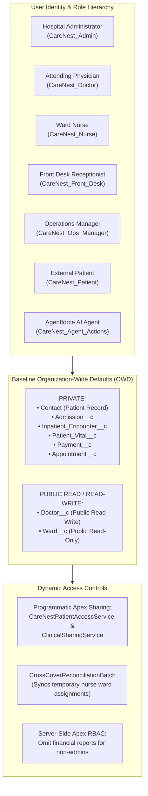

# CareNest — Security Model, Governance & Data Isolation

## 1. Zero-Trust Security Philosophy

Healthcare information systems require defense-in-depth protection. CareNest adheres to the principle of least privilege, establishing strict Organization-Wide Defaults, granular Permission Sets, programmatic row-level Apex sharing, and strict boundary isolation from external projects.

---

## 2. Organization-Wide Defaults (OWD)

| Object API Name | OWD Setting | Justification |
|---|:---:|---|
| `Contact` (Patient) | **Private** | Protects sensitive Patient Health Information (PHI) from unauthorized staff. |
| `Admission__c` | **Private** | Restricts inpatient admission visibility to assigned clinicians and administration. |
| `Inpatient_Encounter__c` | **ControlledByParent** | Inherits privacy from parent `Admission__c`. |
| `Patient_Vital__c` | **ControlledByParent** | Bedside clinical telemetry restricted to medical staff. |
| `Appointment__c` | **Private** | Protects consultation schedules and patient balance information. |
| `Payment__c` | **ControlledByParent** | Inherits privacy from parent `Appointment__c`; accessible to cashier/admin. |
| `Cancellation__c` | **ControlledByParent** | Audit log for cancellations and refund calculations. |
| `Visit_Record__c` | **ControlledByParent** | Physician consultation diagnosis and notes. |
| `Ward__c` | **Public Read Only** | All staff can view ward names and room capacities. |
| `Bed__c` | **ControlledByParent** | Bed statuses and availability inherit from `Ward__c`. |
| `Doctor__c` | **Public Read Write** | Internal staff directory; doctors maintain their consultation availability. |
| `CareNest_Staff_Ward_Assignment__c`| **Private** | Operational assignment records used by sharing automation. |

---

## 3. Permission Set Matrix (9 Dedicated Roles)

CareNest utilizes modular Permission Sets instead of monolithic profiles, enabling agile role adjustments and zero-trust assignment:

| Functional Area | CareNest_Admin | CareNest_Doctor | CareNest_Nurse | CareNest_Front_Desk | CareNest_Ops_Manager | CareNest_Ward_Management | CareNest_Patient | CareNest_Agent_Actions |
|---|:---:|:---:|:---:|:---:|:---:|:---:|:---:|:---:|
| **Patient Registration** | CRUD | Read | Read | CRUD | Read | Read | Self (Read/Edit) | Create |
| **Doctor Directory** | CRUD | Edit Self | Read | Read | CRUD | Read | Read | Read |
| **Appointment Booking** | CRUD | Read | Read | CRUD | CRUD | - | Self (CRUD) | Invocable CRUD |
| **Cashier & Billing** | CRUD | - | - | Create/Read | Read | - | View Own | - |
| **Financial Analytics** | **Full Access** | **DENIED** | **DENIED** | **DENIED** | **DENIED** | **DENIED** | **DENIED** | **DENIED** |
| **Ward & Bed Admin** | CRUD | Read | Read | Read | CRUD | CRUD | - | Invocable Read |
| **Patient Admissions** | CRUD | Read | Read | Read | CRUD | Read | - | - |
| **Clinical Encounters**| CRUD | **CRUD** | Read | - | Read | - | - | - |
| **Bedside Vitals & Alerts**| CRUD | CRUD | **CRUD** | - | Read | - | - | - |
| **Discount Approval** | **Yes** | - | - | - | **Yes** | - | - | - |

---

## 4. Programmatic Apex Sharing

Because inpatient hospital environments dynamically rotate nurses across shifts and assign patients to attending doctors, declarative sharing rules are insufficient.

CareNest implements programmatic sharing services:

### 4.1 `CareNestPatientAccessService.cls`
- When an `Admission__c` record is created or reassigned to an attending doctor, the service dynamically inserts an `Admission__Share` record granting `Edit` access to the doctor's Salesforce User.
- Simultaneously grants `Read` access to the patient's master `Contact` record so the doctor can review demographic and historical consultation records.
- Upon patient discharge, access is transitioned to `Read` for post-discharge review and archival compliance.

### 4.2 `ClinicalSharingService.cls`
- Manages ward-level access: queries active `CareNest_Staff_Ward_Assignment__c` records.
- All nurses actively assigned to "Ward A - ICU" receive row-level visibility to all inpatients currently occupying beds in Ward A.
- Automated reconciliation via `CrossCoverReconciliationBatch` automatically revokes access when nurse shift assignments expire.

---

## 5. Strict Cross-Project Data Isolation (MiniCare vs. CareNest)

In multi-application environments where multiple clinical or outpatient projects exist within the same Salesforce org, rigorous isolation is critical:

1. **Patient Uniqueness & Provenance:** CareNest records enforce unique patient codes (`CN-P-###`) and verified provenance tracking to ensure cross-project records cannot be blended.
2. **Absolute Report Exclusion:** CareNest code and dashboards explicitly ban and exclude all 12 legacy or foreign report IDs (`00Og700000AiDFBEA3`, `00Og700000AvzH7EAJ`, `00Og700000Avzx3EAB`, `00Og700000Avzx4EAB`, `00Og700000Avzx5EAB`, `00Og700000AwzlJEAR`, and `00Og700000B0zVMEAZ`–`00Og700000B0zVREAZ`).
3. **Dedicated Report Folders:** All 16 CareNest reports reside in strictly partitioned folders:
   - `CareNest HMS Reports`
   - `CareNest Clinical Reports`
   - `CareNest Inpatient Reports`
   - `CareNest Outpatient Reports`
4. **Server-Side Financial Security:** `CareNestDashboardController` checks `isUserAuthorizedAdmin()` on the server. Non-admin users are strictly excluded from discovering, viewing, or querying financial metrics or report links.
