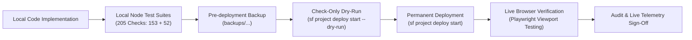

# CareNest — Testing Strategy, CI/CD & Deployment Guide

## 1. Quality Engineering & Testing Philosophy

CareNest enforces a disciplined, multi-layered testing lifecycle:
**PLAN → REVIEW → IMPLEMENT → LOCAL TEST → CHECK-ONLY VALIDATE → PERMANENT DEPLOY → VERIFY**.

A feature is never considered complete merely because the code compiles. Every deployment must pass comprehensive local regression tests, static analysis, Apex unit tests, and post-deployment live browser verification.



---

## 2. Multi-Tiered Testing Strategy

### 2.1 Tier 1: Local Automated Regression Suites (205 Tests)
Before executing any deployment against the Salesforce cloud org, local Node.js test suites perform deep AST and regex static verification across metadata, Apex, HTML, JavaScript, and CSS:

1. **`scripts/test_admin_analytics_local.js` (153 Tests):**
   - Asserts that all 16 CareNest report developer names exist in static allowlists.
   - Verifies 0 forbidden MiniCare report IDs appear in any Controller, HTML, or JS file.
   - Validates accounting label text across UI templates.
   - Verifies CSS responsive breakpoint definitions (`1200px`, `1024px`, `820px`, `640px`, `480px`).
   - Asserts that all 5 category filter buttons and search input handlers are implemented.
2. **`scripts/test_careNestDashboardV2_local.js` (52 Tests):**
   - Verifies that all 12 operational hospital modules are defined.
   - Confirms all child LWC components (`patientAdmissionWorkspace`, `wardBedManager`, `inpatientClinicalWorkspace`, `doctorSearch`, `appointmentWizard`, `patientBilling`, `agentforceAssistantWidget`) are properly registered.
   - Verifies KPI metric handlers, error boundary templates, and `refreshApex` wiring.

**Summary:** 205 / 205 local tests passed (100% pass rate).

### 2.2 Tier 2: Apex Unit Tests & Code Coverage
All business logic is verified using dedicated Apex unit test classes. Unit tests use synthetic data factories, execute within `Test.startTest()` / `Test.stopTest()` governor limit windows, and assert both positive and negative execution paths:

- **`CareNestDashboardControllerTest.cls`:**
  - `testFilterVariations`: Tests date and department query filtering.
  - `testGetAdminOverviewAnalytics_Authorized`: Asserts KPI calculations under `CareNest_Admin`.
  - `testGetAdminOverviewAnalytics_NonAdminDenied`: Verifies access denial for standard users.
  - `testGetDashboardMetrics`: Tests live telemetry aggregations.
  - `testGetRecentActivities`: Tests chronological activity feeds.
  - `testGetReportsHubReports_Admin`: Asserts that an administrator receives all 16 reports and 0 MiniCare IDs.
  - `testGetReportsHubReports_NonAdmin`: Asserts that non-admin users receive 0 financial report links.
  - `testGetWardSummaries`: Tests bed status aggregation across active wards.

### 2.3 Tier 3: Interactive Playwright Browser Automated Testing
To ensure production UI integrity across devices, Playwright automated browser tests execute against the authenticated live Salesforce environment:
- **Multi-Viewport Testing Matrix:**
  - **Desktop (1920x1080):** Verifies full 3-column card layouts, side-by-side revenue analytics charts, and sticky utility headers.
  - **Tablet (820x1180):** Verifies 2-column responsive wrapping, touch-target spacing, and collapsed sidebar states.
  - **Mobile (390x844):** Verifies single-column vertical card stacking, touch navigation drawer, and mobile quick-hub card accessibility.
- **Interactive Verification Checks:**
  - Tab navigation switching across all 12 modules without console errors or layout shifts.
  - Real-time search filtering across the 16 reports in the Reports Hub.
  - Category pill filter toggles (`All`, `Financial Analytics`, `Hospital Operations`, `Clinical & Physician`, `Additional Operations`).
  - Modal dialogues (Cashier Billing Desk POS, Patient Registration, Appointment Booking Wizard).
  - Safety escalation in the Agentforce Assistant widget.

---

## 3. Verified Salesforce Deployment History

CareNest uses Salesforce DX (SFDX) manifests (`package.xml`) for clean, auditable, and idempotent deployments.

### 3.1 Check-Only Validation (Dry-Run)
- **Manifest:** `manifest/phase36-reports-hub-integration-package.xml`
- **Salesforce Async Job ID:** `0Afg700000Gh1E9CAJ`
- **Command Executed:**
  ```powershell
  sf project deploy start --target-org carenest --manifest manifest/phase36-reports-hub-integration-package.xml --dry-run --test-level RunSpecifiedTests --tests CareNestDashboardControllerTest --wait 60 --json
  ```
- **Result:** `Status: Succeeded`, `checkOnly: true`, 3 components validated, 8/8 Apex tests passed, 0 failures.

### 3.2 Permanent Deployment
- **Manifest:** `manifest/phase36-reports-hub-integration-package.xml`
- **Salesforce Async Job ID:** `0Afg700000Gfz38CAB`
- **Command Executed:**
  ```powershell
  sf project deploy start --target-org carenest --manifest manifest/phase36-reports-hub-integration-package.xml --test-level RunSpecifiedTests --tests CareNestDashboardControllerTest --wait 60 --json
  ```
- **Result:** `Status: Succeeded`, `checkOnly: false`, 3 components permanently deployed:
  1. `ApexClass: CareNestDashboardController`
  2. `ApexClass: CareNestDashboardControllerTest`
  3. `LightningComponentBundle: careNestDashboardV2`

---

## 4. Rollback & Disaster Recovery Strategy

CareNest maintains explicit rollback snapshots before every deployment:
- **Snapshot Directory:** `backups/phase36_reports_hub_prevalidation_backup/`
- Contains exact previous source copies of controller classes and LWC bundles.
- If a production regression occurs, immediate restoration can be executed by redeploying the backup directory via SFDX without data loss.
